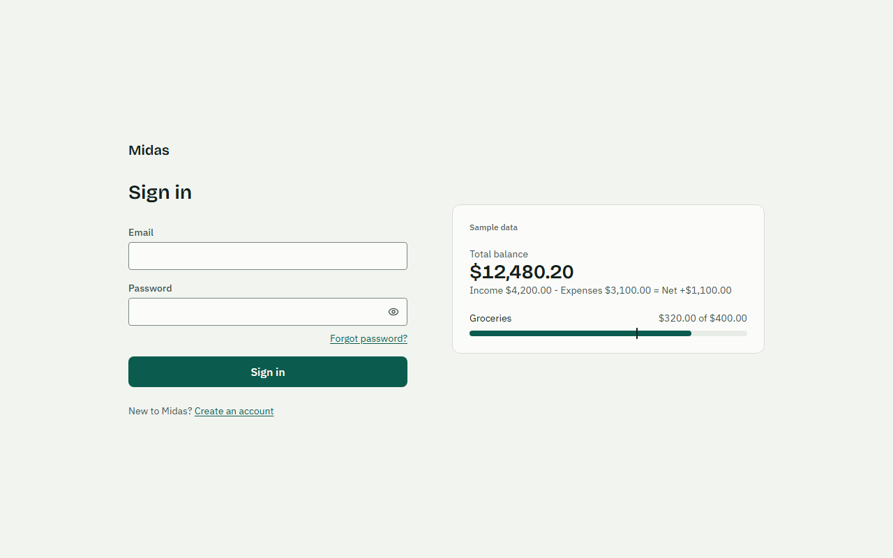
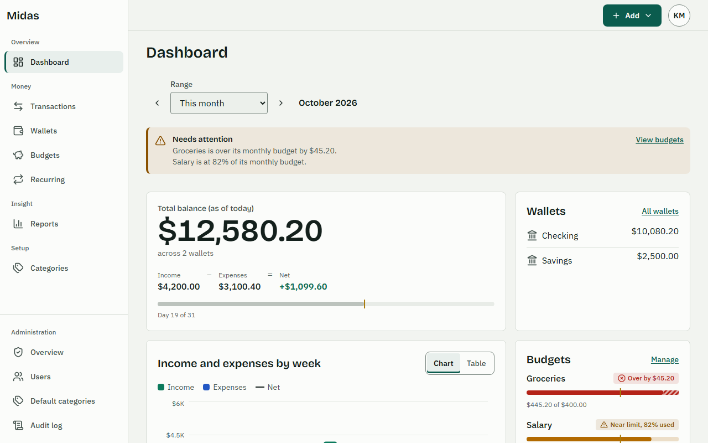
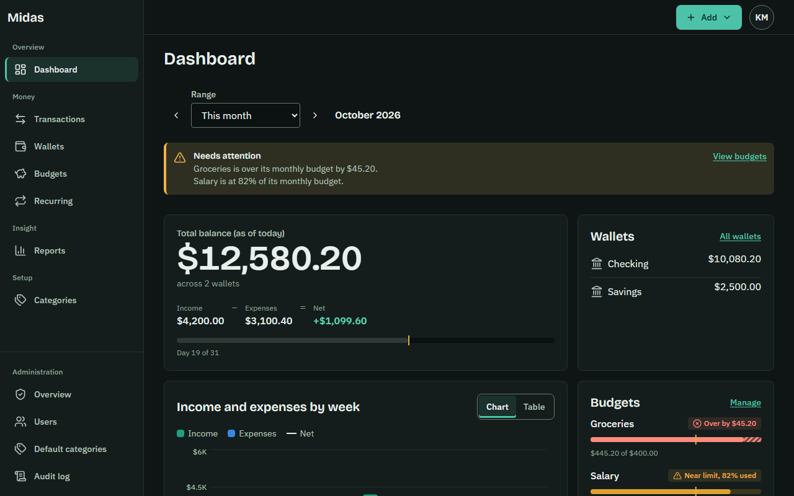
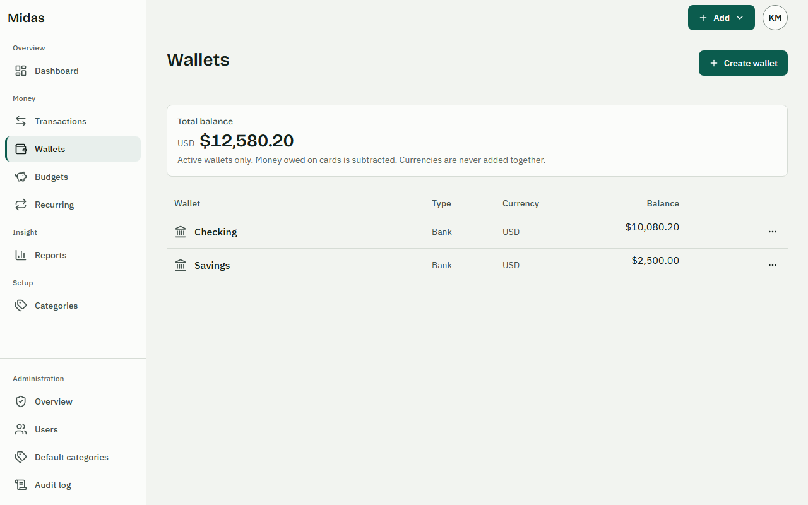
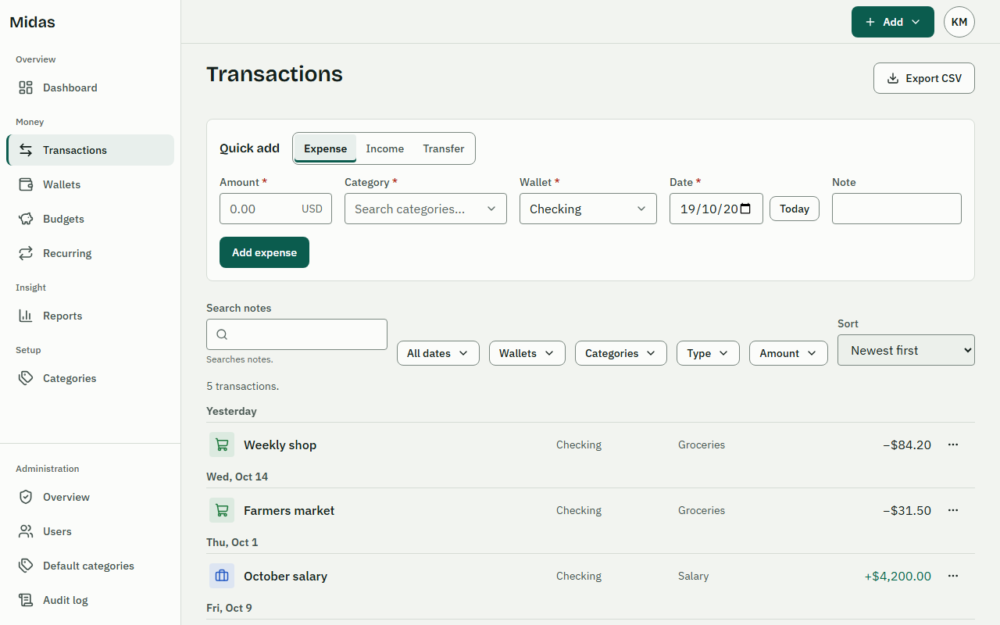
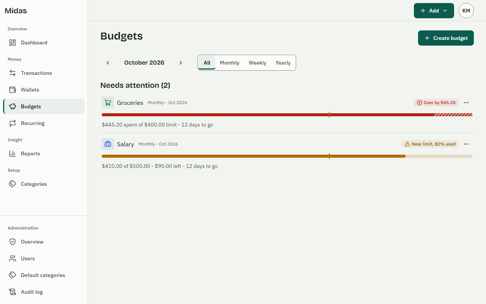
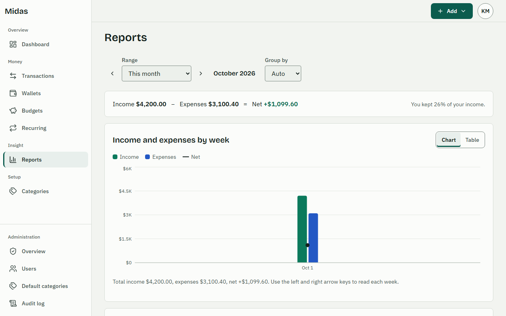
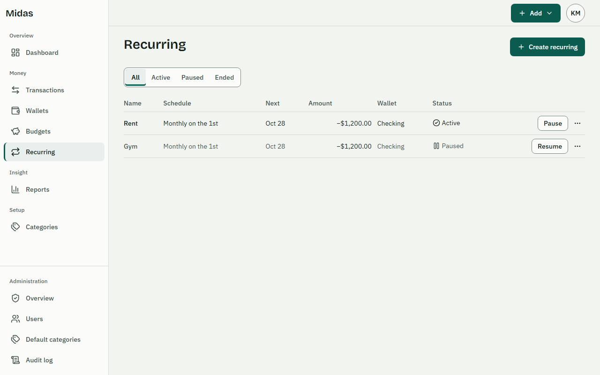
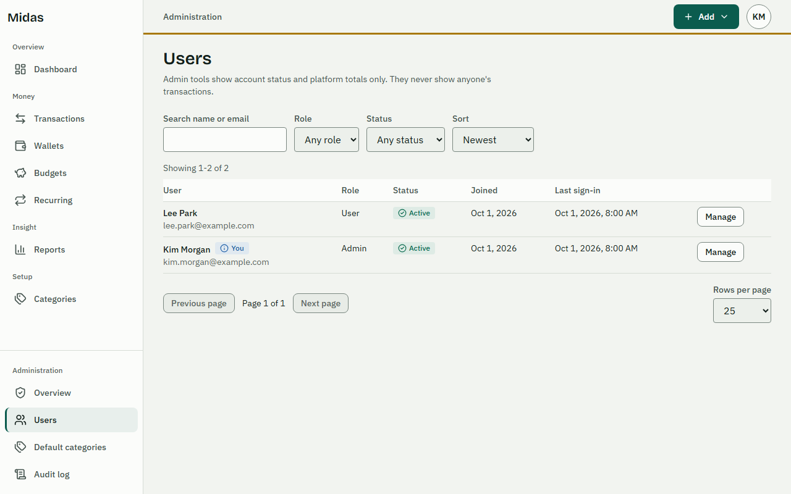

# Midas

A personal finance tracker for recording income, expenses and transfers across multiple wallets, planning spending with budgets, automating regular items, and understanding your money through a dashboard and reports.

> **Status: Sprint 4 (Quality and Release) in progress; v1.0 is not released.** Sprints 1 to 3 are complete: the API and web app cover registration, sign-in, password reset, wallets, categories, transactions, transfers, CSV export, budgets, dashboard and reports, recurring transactions and the admin area. Sprint 4 added security hardening, a production Docker image that serves the web app, coverage thresholds, accessibility, end-to-end and performance checks, and the deployment and troubleshooting guides. Still open before v1.0: review summaries, manual screen-reader testing, the API reference and user guide, and the first CI run of the production-image job; see [docs/operations/release-checklist.md](./docs/operations/release-checklist.md) and the Final Backlog Review in `docs/dev-stories-tracker.md`. Architecture decisions are in [docs/adr/](./docs/adr/README.md); the full documentation map is [docs/README.md](./docs/README.md).

## Features (v1 scope)

- **Dashboard:** balances per wallet and per currency, income vs expense for a period, trends, category breakdown, budget status.
- **Wallets:** cash, bank, card and savings wallets, each in one currency, with an opening balance, archiving and transfers between wallets.
- **Transactions:** income, expense and transfers with categories, search, filters, and CSV export.
- **Categories:** system defaults plus personal categories with icons and colors.
- **Budgets:** weekly, monthly (default) or yearly, overall or per category, with warning and exceeded states.
- **Reports:** income vs expense trends and spending by category.
- **Recurring transactions:** daily, weekly, monthly and yearly templates that generate transactions automatically.
- **Accounts:** registration, sign-in, password reset by email, profile, currency, locale, timezone and light/dark theme.
- **Admin:** user management (search, suspend, reactivate, roles), system categories, platform metrics and an audit log. Admins cannot see users' private financial records.

Out of scope for v1: bank syncing, shared wallets, receipt OCR, native mobile apps, payments and subscriptions.

## Screenshots

The pictures are the real web app rendered against an in-memory fake API, so every name and amount is sample data, not a real account. Regenerate them with `CAPTURE_SCREENSHOTS=1 pnpm --filter @midas/e2e exec playwright test screenshots.spec.ts` (see `e2e/tests/screenshots.spec.ts`).

| | |
| --- | --- |
|  |  |
|  |  |
|  |  |
|  |  |
|  | |

The admin audit log is not pictured: the fake API returns no audit entries, and an empty table shows nothing useful.

## Quickstart

With Docker (needs Docker with Compose, Node.js 24 and Corepack):

```bash
corepack enable
pnpm install
cp .env.example .env            # replace every change-me-* placeholder
docker compose up --build       # then open http://localhost:5173
```

Password reset emails appear in Mailpit at http://localhost:8025. For a first run, follow [Running locally, step by step](#running-locally-step-by-step). Running on the host without containers, the production image and all environment variables are covered in [Local setup](#local-setup), [Docker usage](#docker-usage) and [Environment variables](#environment-variables).

## Running locally, step by step

There are no built-in user accounts or demo logins. You set a few secrets in `.env`, start the stack, then register your own account in the app. The only credentials you need to choose are the two database passwords and the JWT secret.

### 1. Install the prerequisites

- Node.js 24 (`node --version` should print `v24.x`).
- Docker Desktop (or Docker Engine with the Compose plugin), running.
- Git Bash or WSL is handy on Windows for `openssl`, but the Node one-liner in step 3 works in any shell.

### 2. Install dependencies

From the `midas-app` folder:

```bash
corepack enable        # once per machine; gives you the pinned pnpm 10.x
pnpm install
```

### 3. Create `.env` and fill in the secrets

```bash
cp .env.example .env               # PowerShell: Copy-Item .env.example .env
```

Generate random values (run once per secret; any of these works):

```bash
openssl rand -base64 48
node -e "console.log(require('crypto').randomBytes(48).toString('base64'))"
```

Then edit `.env`. These are the only lines you must touch; leave everything else at the template defaults.

| Variable | What to put | Why |
| --- | --- | --- |
| `JWT_ACCESS_SECRET` | A generated value (at least 43 characters) | Signs access tokens. The API refuses to start while it still contains `change-me`. |
| `POSTGRES_PASSWORD` | A password you choose, e.g. a generated value | Password of the database owner role `midas_owner`, which runs migrations. |
| `MIDAS_APP_DB_PASSWORD` | A different password you choose | Password of the restricted `midas_app` role the API connects as. |
| `DATABASE_MIGRATION_URL` | `postgres://midas_owner:<POSTGRES_PASSWORD>@localhost:5432/midas` | Only used when you run the API on the host (option B). The password must equal `POSTGRES_PASSWORD`. |
| `DATABASE_URL` | `postgres://midas_app:<MIDAS_APP_DB_PASSWORD>@localhost:5432/midas` | Only used when you run the API on the host (option B). The password must equal `MIDAS_APP_DB_PASSWORD`. |

Notes:

- Generated base64 values can contain `/`, `+` and `=`. They are fine in `JWT_ACCESS_SECRET`, but inside a `postgres://` URL they must be percent-encoded. The easy way out is to use letters and digits only for the two database passwords (for example `openssl rand -hex 24`).
- The database passwords are only accepted by PostgreSQL on the **first** start, when the data volume is created (`infra/db/init/01-app-roles.sh` creates `midas_app` then). If you change them later, reset the database with `docker compose down -v` so they are applied again; this deletes all local data.
- Optional extras: `AUDIT_HMAC_SECRET` (at least 32 characters) adds an email hash to audit rows for failed sign-ins on unknown accounts; `METRICS_TOKEN` enables `GET /metrics`. Neither is needed to use the app.
- Mail needs nothing: the template already points at Mailpit (`SMTP_HOST=localhost`, `SMTP_PORT=1025`, no user or password).

### 4. Start the app

**Option A: everything in Docker (recommended).**

```bash
docker compose up --build
```

This starts PostgreSQL, Mailpit, runs the migrations and system category seed once, then starts the API and the web app with hot reload. In this mode Compose builds the database URLs and SMTP settings itself from `POSTGRES_PASSWORD` and `MIDAS_APP_DB_PASSWORD`, so `DATABASE_URL` and `DATABASE_MIGRATION_URL` in `.env` are not used. Wait until the `api` log shows the server listening.

**Option B: database in Docker, API and web on the host.**

```bash
docker compose up -d db mailpit
pnpm --filter @midas/api migrate
pnpm --filter @midas/api seed:system
pnpm --filter @midas/api dev       # terminal 1, port 3000
pnpm --filter @midas/web dev       # terminal 2, port 5173
```

Here `DATABASE_URL` and `DATABASE_MIGRATION_URL` from `.env` are used, so their passwords must match step 3.

### 5. Open the app and create your account

1. Open http://localhost:5173.
2. Choose **Create an account** and sign up with any email and a password of at least 12 characters that the strength meter accepts (a short common phrase is rejected). The email is not verified, so a made-up address works.
3. Sign in. Your account is a normal user; the system categories are already there.

To test "Forgot password", request a reset in the app and open the email in Mailpit at http://localhost:8025.

### 6. (Optional) Create an admin account

Nobody becomes admin by registering. With the Compose stack running:

```bash
# Create a new admin account (prompts for the password)
docker compose exec api node --import tsx src/cli.ts admin:create --email admin@example.com

# Or make your existing account an admin
docker compose exec api node --import tsx src/cli.ts admin:promote --email you@example.com
```

When running on the host (option B), use `pnpm --filter @midas/api cli admin:create --email ...` or `cli admin:promote --email ...` instead. Sign out and back in to see the Admin area.

### 7. Stop or reset

```bash
docker compose down        # stop, keep your data
docker compose down -v     # stop and delete the database (fresh start)
```

### Common problems

| Symptom | Cause and fix |
| --- | --- |
| `set POSTGRES_PASSWORD in .env` or `set MIDAS_APP_DB_PASSWORD in .env` | `.env` is missing or the variable is empty. Do step 3. |
| API exits with `JWT_ACCESS_SECRET: placeholder value is not allowed` or `must be at least 43 characters` | Replace it with a generated value. |
| `password authentication failed for user "midas_app"` or `"midas_owner"` | The passwords in `.env` differ from the ones the volume was created with. Run `docker compose down -v` and start again, or (option B) fix the passwords in the URLs. |
| Port 5432, 3000 or 5173 already in use | Stop the other PostgreSQL or dev server, or the old Midas containers. |
| `localhost:5173` does not load in option A | A Vite server on the host is answering first; stop it or open http://127.0.0.1:5173. |
| Login says too many attempts | Rate limits are on by default. Wait a minute, or restart the API to clear the in-memory counters. |

## Tech stack

| Area | Choice |
| --- | --- |
| Runtime and package manager | Node.js 24, pnpm 10 workspaces (via Corepack) |
| Backend | TypeScript, Fastify 5, Zod 4, argon2id, jose (JWT) |
| Frontend | React 19, Vite, Tailwind CSS v4, Radix UI |
| Database | PostgreSQL 17, Kysely on `pg`, node-pg-migrate |
| Mail | SMTP (Mailpit for local development) |
| Testing | Vitest, Testcontainers |
| Delivery | Docker, Docker Compose, GitHub Actions |

The web app also uses TanStack Router and Query; browser tests use Playwright (`e2e/`) and component tests use vitest-axe. Charts use Recharts (SVG only, animation off, no injected `<style>`), loaded lazily; `e2e/tests/csp.spec.ts` checks them under a strict CSP against a production build (opt-in, see the file header).

## Architecture summary

- **Modular monolith.** One Fastify process hosts the domain modules. The React SPA is built separately and served from the same origin by the API in the production image (`WEB_DIST_DIR`), so there is no CORS and one thing to deploy. In development Vite serves it and proxies `/api`.
- **Shared package.** `@midas/shared` holds Zod schemas and helpers used by both apps.
- **Money** is stored as integer minor units.
- **Database.** PostgreSQL 17 with SQL migrations (node-pg-migrate) and generated Kysely types. The app connects as a restricted role; migrations run as the owner role (`DATABASE_MIGRATION_URL`).
- **Security.** See "Security notes" below. Passwords hashed with argon2id, configuration validated at boot (fail fast, values never echoed), placeholder secrets rejected outside tests, helmet headers, rate limiting on auth and API endpoints, strict CSP for the SPA (no inline scripts or styles), gitleaks secret scanning and dependency audit in CI. See [SECURITY.md](./SECURITY.md).

## Repository structure

```
midas-app/
├─ apps/
│  ├─ api/          # @midas/api: Fastify backend (src/modules, src/platform, db migrations and seeds)
│  └─ web/          # @midas/web: React + Vite frontend and design system
├─ packages/
│  └─ shared/       # @midas/shared: shared Zod schemas and helpers
├─ tooling/         # shared tooling presets
├─ e2e/             # Playwright end-to-end suites (pnpm test:e2e)
├─ infra/           # Dockerfile and database init scripts
├─ .github/         # CI workflow, Dependabot, templates
├─ compose.yaml  .env.example  package.json  pnpm-workspace.yaml
└─ README.md  CONTRIBUTING.md  SECURITY.md  LICENSE
```

## Scripts

| Command | What it does |
| --- | --- |
| `pnpm install` | Install dependencies |
| `pnpm lint`, `pnpm format:check`, `pnpm typecheck` | ESLint, Prettier check, `tsc --noEmit` |
| `pnpm format` | Prettier, writes changes |
| `pnpm test` | Unit and integration tests in shared, api and web |
| `pnpm test:coverage` | Same with V8 coverage; thresholds fail the run (enforced in CI) |
| `pnpm build` | Build every workspace that defines a build script |
| `pnpm test:e2e` | Playwright suites in `e2e/` |
| `pnpm --filter @midas/api dev` / `pnpm --filter @midas/web dev` | API (watch) and Vite dev servers |
| `pnpm --filter @midas/api test:perf` | 100,000 transaction performance baseline (needs Docker; not part of `pnpm test`) |
| `pnpm --filter @midas/api migrate` and related | Database migrations, see below |

## Local setup

Prerequisites: Node.js 24, Corepack (ships with Node), and Docker with Compose for the database.

```bash
corepack enable                 # once per machine; pins pnpm to the packageManager version (10.x)
pnpm install
cp .env.example .env            # then replace every change-me-* placeholder
```

Generate a JWT secret with, for example, `openssl rand -base64 48`.

### Run with Docker Compose

```bash
docker compose up --build       # PostgreSQL 17, Mailpit, one-shot migrate, API (watch), web (Vite)
```

- The `migrate` service is one-shot: it runs `migrate` then `seed:system` through the owner role (`DATABASE_MIGRATION_URL`) and exits. `api` starts only after it succeeds.
- **Hot reload.** `apps/api/src`, `apps/api/db`, `apps/web/src` and `packages/shared/src` are bind-mounted read-only into the containers. The API runs under `tsx watch` and restarts on edits; the web app runs the Vite dev server with hot module replacement. File watching uses polling so edits made on a Windows or macOS host are seen. Changes to dependencies, lockfile, Vite config or the Dockerfile need `docker compose up --build`.
- Open the app at http://localhost:5173. Vite proxies `/api` and `/health` to the API, so the browser stays same-origin (no CORS).
- Mailpit receives development mail (password reset emails); read it at http://localhost:8025.
- Container networking overrides `DATABASE_URL`, `DATABASE_MIGRATION_URL`, `APP_BASE_URL` (`http://localhost:5173`) and the SMTP settings, so the values in `.env` (written for running on the host) are not used by these services. `.env` must still define `POSTGRES_PASSWORD` and `MIDAS_APP_DB_PASSWORD`. The web container does not receive `.env`.
- If the web app does not load at `localhost:5173`, check for a Vite dev server already running on the host: it can answer on IPv6 `localhost` ahead of the container. Stop it or open http://127.0.0.1:5173.

| Service                   | URL                   |
| ------------------------- | --------------------- |
| Web app (Vite)            | http://localhost:5173 |
| API                       | http://localhost:3000 |
| Mailpit UI (SMTP on 1025) | http://localhost:8025 |
| PostgreSQL                | localhost:5432        |

Ports are published on 127.0.0.1 only. Reset local data with `docker compose down -v`.

### Run the apps in development

```bash
pnpm --filter @midas/api dev    # API with watch mode, loads ../../.env (port 3000)
pnpm --filter @midas/web dev    # Vite dev server (port 5173), proxies /api to the API
```

To run the two dev servers on the host instead of in containers, start only the backing services: `docker compose up -d db mailpit`, then `migrate` and `seed:system` (below), then the two dev servers. Set `CORS_ORIGINS` only if the browser calls the API from an origin other than the Vite proxy.

### Docker usage

- **Development:** `docker compose up --build` uses the `dev` stage of `infra/docker/Dockerfile`.
- **Production image:** `docker build -f infra/docker/Dockerfile --target runtime -t midas:local .` builds a multi-stage image with compiled JavaScript, production dependencies only, a non-root user and a healthcheck on `/health`. The API serves the built web app from the same origin (`WEB_DIST_DIR`). Running it needs a migrated database and the environment variables above; see [docs/operations/deployment.md](./docs/operations/deployment.md).
- **CI:** the `production-image` job builds the image, runs the migrations and seed, smoke-tests it and runs the whole Playwright suite against it. It passed on GitHub on pull request 9 (run 39265739192), including the coverage step in the main job.

### Database migrations

Run from the repository root; each maps to a script in `apps/api/package.json`.

```bash
pnpm --filter @midas/api migrate          # apply pending migrations
pnpm --filter @midas/api migrate:down     # roll back
pnpm --filter @midas/api migrate:status   # show applied/pending
pnpm --filter @midas/api migrate:verify   # up, down to zero, up; checks catalogs are identical
pnpm --filter @midas/api seed:system      # idempotent system categories; run after migrate
pnpm --filter @midas/api db:codegen       # regenerate Kysely types from the database
pnpm --filter @midas/api db:migrate:create <name>   # scaffold a new migration
```

`migrate`, `migrate:down`, `migrate:status`, `migrate:verify` and `seed:system` connect through `DATABASE_MIGRATION_URL` (owner role). Schema design, conventions, role setup and the release procedure are in [apps/api/db/README.md](./apps/api/db/README.md).

### Backup and restore (local)

Backup and restore (PostgreSQL logical dumps):

```bash
docker compose exec db pg_dump -U midas_owner -Fc midas > midas.dump
docker compose exec -T db pg_restore -U midas_owner -d midas --clean --if-exists < midas.dump
```

Production targets: provider point-in-time recovery, daily encrypted logical dumps, and restores always into a new instance, never over the live one. The `db:check` integrity command is planned and not implemented. Production backup, restore and rollback steps are in the [deployment guide](./docs/operations/deployment.md); other runbooks live in [docs/operations/](./docs/operations/README.md).

## Checks and tests

```bash
pnpm lint
pnpm format:check
pnpm typecheck
pnpm test
pnpm build
pnpm test:e2e                   # Playwright against the Vite dev server with a fake API (no database)
# Against the production build served by the API, under its real CSP (what CI does with the image):
#   E2E_BASE_URL=http://localhost:3000 E2E_SERVED_BUILD=1 pnpm test:e2e
```

- `pnpm test` runs Vitest in `@midas/shared`, `@midas/api` and `@midas/web`.
- **Coverage:** `pnpm test:coverage` (V8) enforces per-package thresholds, which CI also runs. Floors sit a few points below the last measured values (lines at the last QA run: shared 96.6%, api 93.4%, web 88.1%); the thresholds themselves live in each package's Vitest config.
- **Accessibility:** `e2e/tests/a11y.spec.ts` runs axe-core (WCAG 2.1 A and AA) on the main routes in light and dark themes; `e2e/tests/keyboard.spec.ts` checks keyboard flows; `apps/web/src/styles/contrast.test.ts` checks token contrast. Manual screen-reader testing (NVDA, VoiceOver) has not been done. Results and open issues: [docs/qa/accessibility-audit.md](./docs/qa/accessibility-audit.md).
- **Performance:** `pnpm --filter @midas/api test:perf` seeds 100,000 transactions on PostgreSQL 17 and checks list, report, dashboard and export timings against limits. Targets and measurements: [docs/qa/performance-baseline.md](./docs/qa/performance-baseline.md). Concurrent load is not measured.
- **Test map:** [docs/qa/acceptance-test-map.md](./docs/qa/acceptance-test-map.md) lists the tests per story.
- Database-backed API tests use Testcontainers, which **needs Docker**, or an existing PostgreSQL 17 server when `TEST_DATABASE_URL` is set (admin URL; a throwaway database is created and dropped). They are skipped when neither is available, so a green run without Docker does not exercise them.
- Do not substitute PGlite: it is PostgreSQL 18 and fails some DB tests (different SQLSTATE for `ON DELETE RESTRICT`, lost protocol sync after errors).
- Watch mode: `pnpm --filter @midas/api test:watch`.
- `pnpm test:e2e` specs intercept `/api/v1` with an in-memory fake. Set `E2E_BASE_URL` to target an already running app instead of starting Vite. Install the browser once with `pnpm --filter @midas/e2e exec playwright install chromium` (add `--with-deps` on a fresh Linux machine; CI does).
- **Opt-in real-API e2e** (`e2e/tests/real-api.spec.ts`) needs a running API on PostgreSQL 17 with `migrate` and `seed:system` applied: `E2E_REAL_API=1 E2E_BASE_URL=http://localhost:5173 pnpm test:e2e -- real-api`. The password-reset spec also needs `E2E_MAIL_LOG` set to the API log file, with the API started using `MAIL_TRANSPORT=console` and `LOG_LEVEL=info`. Without `E2E_REAL_API=1` these specs are skipped.
- **Production build under the real CSP.** The CI job "Production image" builds the Docker image, runs it on PostgreSQL and runs the whole suite against it with `E2E_BASE_URL`, `E2E_SERVED_BUILD=1` and `E2E_REAL_API=1`. `E2E_SERVED_BUILD=1` makes every test fail on any `securitypolicyviolation` from the server's own `Content-Security-Policy` header and enables `e2e/tests/csp.spec.ts`. To do the same locally, build (`pnpm build`), start the API from `apps/api` (`node --env-file=../../.env dist/server.js`, it serves `apps/web/dist`) and set those variables. On Windows Playwright's `webServer` cannot find `pnpm`, so always use `E2E_BASE_URL` there.

## Environment variables

[`.env.example`](./.env.example) lists all variables with placeholders only; never commit real secrets. The API validates the variables below at boot (`apps/api/src/platform/config.ts`) and exits with a clear error when one is invalid.

| Variable | Required | Default | Notes |
| --- | --- | --- | --- |
| `NODE_ENV` | no | `development` | `development`, `test` or `production` |
| `HOST` | no | `0.0.0.0` | Bind address |
| `PORT` | no | `3000` | 1 to 65535 |
| `LOG_LEVEL` | no | `info` | `fatal` to `trace`, or `silent` |
| `APP_BASE_URL` | production: yes | `http://localhost:5173` | Public URL used in reset links. Must be set and use `https` in production |
| `APP_VERSION` | no | `0.0.0` | Reported by `GET /health` |
| `TRUST_PROXY` | no | `0` | Reverse-proxy hops to trust (0 to 10) |
| `DATABASE_URL` | yes | none | `postgres://` URL for the app role |
| `DATABASE_MIGRATION_URL` | no | `DATABASE_URL` | Owner role used by migrations |
| `DATABASE_POOL_MAX` | no | `10` | Max 200 |
| `DATABASE_STATEMENT_TIMEOUT_MS` | no | `15000` | |
| `DATABASE_SSL` | no | `verify-full` in production, else `off` | `off`, `require`, `verify-full`; `off` is rejected in production |
| `DATABASE_SSL_CA` | no | none | CA certificate for `verify-full` |
| `JWT_ACCESS_SECRET` | yes | none | At least 43 characters; `change-me` placeholders rejected outside `NODE_ENV=test` |
| `ACCESS_TOKEN_TTL_SECONDS` | no | `600` | Max 3600 |
| `REFRESH_TOKEN_TTL_DAYS` | no | `30` | Max 365 |
| `SESSION_ABSOLUTE_TTL_DAYS` | no | `90` | Must be >= `REFRESH_TOKEN_TTL_DAYS` |
| `RATE_LIMIT_ENABLED` | no | `true` | |
| `RATE_LIMIT_REGISTER_MAX` | no | `5` | Registrations per IP per window |
| `RATE_LIMIT_REGISTER_WINDOW_SECONDS` | no | `3600` | |
| `RATE_LIMIT_LOGIN_MAX` | no | `5` | Login attempts per IP + email, per minute |
| `RATE_LIMIT_LOGIN_IP_MAX` | no | `20` | Login attempts per IP, per minute |
| `RATE_LIMIT_LOGIN_ACCOUNT_MAX` | no | `20` | Login attempts per account (email hash) from any IP, per hour; see Security notes |
| `RATE_LIMIT_FORGOT_EMAIL_MAX` | no | `3` | Forgot-password requests per email hash, per hour |
| `RATE_LIMIT_FORGOT_IP_MAX` | no | `10` | Forgot-password requests per IP, per hour |
| `RATE_LIMIT_RESET_MAX` | no | `10` | Reset and verify requests per IP, per hour |
| `RATE_LIMIT_REFRESH_MAX` | no | `30` | Per session (IP when the cookie is missing or malformed), per minute |
| `RATE_LIMIT_REFRESH_IP_MAX` | no | `60` | All refresh attempts per IP, per minute (backstop for forged session ids) |
| `RATE_LIMIT_PASSWORD_CHANGE_MAX` | no | `10` | Per user, per hour |
| `RATE_LIMIT_USER_WRITE_MAX` | no | `120` | Authenticated writes per user, per minute |
| `RATE_LIMIT_USER_READ_MAX` | no | `600` | Authenticated reads per user, per minute |
| `RATE_LIMIT_GLOBAL_IP_MAX` | no | `1200` | All `/api` requests per IP, per minute |
| `RATE_LIMIT_STORE_MAX_KEYS` | no | `25000` | Capacity of each limiter's in-memory LRU store (max 1000000) |
| `TEST_DATABASE_URL` | no | none | Tests only, see above |
| `TEST_DATABASE_IMAGE` | no | `postgres:17-bookworm` | Tests only, Testcontainers image |
| `POSTGRES_USER`, `POSTGRES_PASSWORD`, `POSTGRES_DB`, `MIDAS_APP_DB_PASSWORD` | Compose | see `.env.example` | Used by the Compose database container only |
| `MAIL_TRANSPORT` | no | `smtp` (`memory` when `NODE_ENV=test`) | `smtp`, `console` or `memory`. Must be `smtp` in production. `console` logs recipient and subject only (body too in development) |
| `MAIL_FROM` | no | `Midas <no-reply@localhost>` | Sender address |
| `SMTP_HOST` | no | `localhost` | |
| `SMTP_PORT` | no | `1025` | 1 to 65535 |
| `SMTP_SECURE` | no | `false` | `true` = implicit TLS (port 465). In production with `false`, STARTTLS is required and the server certificate is verified; local dev (Mailpit) stays plaintext |
| `SMTP_USER`, `SMTP_PASSWORD` | no | none | SMTP credentials |
| `CORS_ORIGINS` | no | none | Development only. Comma-separated `scheme://host[:port]` origins, no paths or wildcards; invalid values fail boot. Ignored in production (same-origin SPA, no CORS headers) |
| `RATE_LIMIT_EXPORT_MAX` | no | `10` | CSV exports per user, per minute |
| `SCHEDULER_ENABLED` | no | `true` | Run the in-process scheduler (recurring generation, daily housekeeping). Safe to leave on for several instances |
| `SCHEDULER_INTERVAL_SECONDS` | no | `300` | Pause between passes, 1 to 86400 |
| `RECURRING_MAX_CATCHUP` | no | `31` | Most occurrences generated per template per pass (max 366) |
| `RECURRING_MAX_FAILURES` | no | `5` | Consecutive failures after which a template is paused (max 100) |
| `METRICS_TOKEN` | no | none | At least 32 characters from `A-Za-z0-9._~+/=-`; enables `GET /metrics`. `change-me` placeholders rejected outside `NODE_ENV=test` |
| `AUDIT_HMAC_SECRET` | no | none | At least 32 characters; pseudonymizes the email of failed sign-ins for unknown accounts in the audit log. Without it those rows carry no email hash (a warning is logged in production) |
| `BOOTSTRAP_ADMIN_EMAIL` | no | none | One-time: while no admin exists, creates this account as admin at boot with an unusable password (set a real one with "Forgot password"). Refuses, with an error log, if the email already has an account. Remove it afterwards |
| `EXPORT_MAX_DURATION_SECONDS` | no | `300` | Absolute time cap per CSV export; a slower download is aborted |
| `DATABASE_MAINTENANCE_URL`, `AUDIT_RETENTION_DAYS`, `SEED_DEMO_PASSWORD` | no | see `.env.example` | Listed for later work (audit purge, dev seed); not read by the config module yet |
| `WEB_DIST_DIR` | no | `../web/dist` from the working directory (`/app/web` in the image) | Folder with the built web app, served from the API origin. If it has no `index.html` the API runs without it |
| `E2E_BASE_URL`, `E2E_SERVED_BUILD`, `E2E_REAL_API`, `E2E_MAIL_LOG` | no | none | Playwright only, see Checks and tests |

The web dev server also reads `VITE_DEV_HOST` (see [CONTRIBUTING.md](./CONTRIBUTING.md)).

## API

Base path `/api/v1`. Request and response shapes, the error format, pagination and the endpoint index are in the OpenAPI 3.1 draft, [apps/api/openapi/openapi.yaml](./apps/api/openapi/openapi.yaml), each operation is tagged `x-implementation-status` (implemented or planned), and a test keeps it in sync with the registered routes.

Implemented (Sprint 2 and Sprint 3):

| Area | Endpoints |
| --- | --- |
| Ops | `GET /health` (liveness, database readiness, `APP_VERSION`); `GET /metrics` (Prometheus text, `Authorization: Bearer <METRICS_TOKEN>`, 404 while `METRICS_TOKEN` is unset; at the root, not under `/api`) |
| Auth | `POST /auth/register`, `/auth/login`, `/auth/refresh`, `/auth/logout`, `/auth/password/forgot`, `/auth/password/reset/verify`, `/auth/password/reset` |
| Me | `GET /me`, `PATCH /me`, `POST /me/password` |
| Wallets | `GET, POST /wallets`; `GET, PATCH, DELETE /wallets/{walletId}`; `POST /wallets/{walletId}/archive` and `/unarchive` |
| Categories | `GET, POST /categories`; `PATCH, DELETE /categories/{categoryId}` |
| Transactions | `GET, POST /transactions`; `GET /transactions/export` (streamed CSV, formula-injection safe, 10 per minute per user); `GET, PATCH, DELETE /transactions/{transactionId}` |
| Transfers | `POST /transfers`; `GET, PATCH, DELETE /transfers/{transferId}` |
| Budgets | `GET, POST /budgets`; `GET, PATCH, DELETE /budgets/{budgetId}`. Status (spent, remaining, percent, `ok`/`warning`/`exceeded`) is computed on read for the period that contains `?date` |
| Reports | `GET /reports/summary`, `/reports/trend`, `/reports/category-breakdown` (per currency, transfers excluded) |
| Recurring | `GET, POST /recurring-templates`; `POST /recurring-templates/preview`; `GET, PATCH, DELETE /recurring-templates/{templateId}`; `POST .../pause` and `.../resume`; `GET .../runs` |
| Admin | `GET /admin/users`, `GET /admin/users/{userId}`, `POST .../suspend` and `.../reactivate`, `PATCH .../role`; `GET, POST /admin/categories`, `PATCH /admin/categories/{categoryId}`, `POST .../retire` and `.../restore`; `GET /admin/metrics`; `GET /admin/audit-logs`. Admin only (role read from the database on every request); none of them returns financial data |

Authenticated routes expect `Authorization: Bearer <access token>`; the refresh token travels only in the `midas_rt` cookie.

Report ranges default to the current calendar month in the user's time zone; a missing `from` or `to` takes that month's bound, and a range that ends up inverted is a `400`.

### Command line and background work

```bash
pnpm --filter @midas/api cli admin:create --email you@example.com [--display-name Name] [--password-stdin]
pnpm --filter @midas/api cli admin:promote --email you@example.com
pnpm --filter @midas/api cli jobs:run recurring     # one generation pass, then exit (for cron hosts)
```

- **First admin (ADR-013):** `admin:create` creates a NEW admin account: it prompts for the password (hidden) or reads one line from stdin with `--password-stdin`, and fails if the email already has an account (registration does not verify email ownership, so an existing account is never promoted by email alone). To make an existing account admin, run `admin:promote --email <email>` as an explicit operator action; it writes an `admin.user_role_changed` audit row. `BOOTSTRAP_ADMIN_EMAIL` creates the account itself at boot, only while no admin exists, with a random unusable password; the owner then uses "Forgot password" (proof of mailbox control). If that email already has an account, boot logs an error and promotes nothing. Unset it afterwards. Nobody becomes admin by registering.
- **Export limits:** one concurrent CSV export per user (a second gets 429), a process-wide cap, and an absolute time cap (`EXPORT_MAX_DURATION_SECONDS`). If an export fails or is cut off after the 200 header was sent, the server destroys the connection so the client sees an aborted, truncated download instead of a clean 200 with a short file.
- **Admin users list:** `page` is capped at 1000 (100,000 rows at `pageSize` 100); narrow with `q`, `role` or `status` to go deeper. `GET /admin/audit-logs` requires `targetType` whenever `targetId` is given.
- **Audit request ids:** `audit_logs.request_id` is always generated by the server; the client `X-Request-Id` only correlates logs and the response header.
- **Known gap (tracked TODO):** there is no retention purge yet for `audit_logs` (`db:purge-audit`) or `recurring_runs` (400 days). Both tables grow unbounded until it is built; see the Final Backlog Review in `docs/dev-stories-tracker.md`.
- **Recurring scheduler (ADR-011):** with `SCHEDULER_ENABLED=true` the server runs a pass every `SCHEDULER_INTERVAL_SECONDS` (first pass about 5 seconds after start) and a daily housekeeping job. Passes claim due templates with row locks that skip locked rows and write one run row per occurrence (unique key), so several instances can run it safely. Catch-up: every missed occurrence is generated on its own date, at most `RECURRING_MAX_CATCHUP` per template per pass. A failed occurrence is recorded and retried on the next pass; after `RECURRING_MAX_FAILURES` in a row the template is paused. An archived wallet or retired category records a skipped run and pauses the template. On shutdown the scheduler stops between occurrences before the pool closes.
- **Audit log:** auth events (register, sign-in success and failure, suspended sign-in, logout, token reuse, password reset and change) are written best-effort after the main work. Admin actions are written in the same transaction as the change. Metadata never holds passwords, tokens, amounts or notes; failed sign-ins for unknown emails store only an HMAC (`AUDIT_HMAC_SECRET`).

## Security notes

- **Access token:** short-lived HS256 JWT (`ACCESS_TOKEN_TTL_SECONDS`, default 600), sent as a bearer token; only HS256 is accepted.
- **Refresh token:** format `<session uuid>.<43 base64url chars>` (32 random bytes). Only its SHA-256 hash is stored. Sent as the `midas_rt` cookie (`HttpOnly; Secure; SameSite=Strict; Path=/api/v1/auth`). The session id inside is not trusted; it only identifies which session to revoke.
- **Rotation and reuse detection:** each refresh rotates the token. A superseded token seen inside the grace window rotates again; outside it the token counts as replayed and the whole session is revoked (`reuse_detected`). A replayed token older than the immediately previous one still revokes the session it names. Malformed tokens are rejected without a database lookup. Sessions also end at `SESSION_ABSOLUTE_TTL_DAYS`.
- **Rate limits:** fixed windows per endpoint (login per IP+email and per IP per minute, login per account per hour, forgot-password, reset, refresh, password change, per-user read/write, global per-IP). Only the maximums are tunable through `RATE_LIMIT_*`. Counters are in memory, one LRU store per limiter capped by `RATE_LIMIT_STORE_MAX_KEYS`, so they reset on restart and are not shared across instances (single API instance assumed; running several needs a shared store behind `createLimiter` in `apps/api/src/platform/rate-limit.ts`, the single seam where counters are kept). Limited responses are `429` problem+json with `Retry-After` and `RateLimit-*` headers. Set `TRUST_PROXY` correctly behind a reverse proxy, otherwise all clients share one IP.
- **Per-account login limiter trade-off:** `RATE_LIMIT_LOGIN_ACCOUNT_MAX` caps attempts against one account from any IP, which blunts distributed credential stuffing, but an attacker who knows an email can send failing attempts to lock that account out of logging in until the hour window rolls over.
- **Reset throttling trade-off:** forgot-password is throttled per email hash and per IP, so a third party can use up a victim's per-email allowance and delay the victim's own reset requests for the window. The exact response behaviour is defined by the `POST /api/v1/auth/password/forgot` operation in the OpenAPI draft.
- **Admin boundary (ADR-018):** admin routes sit behind the normal authentication and a role check against the database row of the current request, so a demotion or suspension applies on the next call. Role changes and suspensions are serialized under an advisory lock (never the last active admin, never yourself) and audited in the same transaction. No admin endpoint returns or aggregates a user's wallets, transactions, budgets or templates; tests enumerate the routes and the API description to keep it that way.
- **CSV export:** text cells that start with `=`, `+`, `-`, `@`, tab or carriage return get a leading `'`; amounts are plain signed decimals. The file is streamed from a read-only transaction through a server-side cursor with at most 3 exports running per process, and an abandoned download releases its connection.
- **Metrics:** `/metrics` is disabled until `METRICS_TOKEN` is set, compares the token in constant time, is rate limited per IP, and labels requests with the matched route pattern only.
- **Production checks (fail fast at boot):** `APP_BASE_URL` set and `https`; `MAIL_TRANSPORT=smtp`; `DATABASE_SSL=off` rejected; placeholder JWT secret rejected; SMTP must use STARTTLS (or `SMTP_SECURE=true`) with certificate verification.
- Vulnerability reporting and secret handling: [SECURITY.md](./SECURITY.md).

## Deployment notes

- Full guide: [docs/operations/deployment.md](./docs/operations/deployment.md) (image, environment variables, migrations, first admin, reverse proxy and HTTPS, scheduler, rollback, backup and restore).
- One image (`infra/docker/Dockerfile`, target `runtime`): compiled JavaScript, production dependencies only, non-root, healthcheck on `/health`, and the API serves the built web app. CI builds it, smoke-tests it and runs the whole Playwright suite against it.
- Release procedure: run `node dist/cli.js migrate && node dist/cli.js seed:system` with the new image before starting it.
- Rate-limit counters are in memory, so they are per instance; see the guide before running more than one.

## Roadmap

| Sprint | Name | Focus |
| --- | --- | --- |
| 1 | Foundation | Monorepo, CI, Docker, API and web skeletons, design system, migrations, registration (complete) |
| 2 | Core Features (implemented) | Login and sessions, password reset, settings, wallets, categories, transactions, transfers |
| 3 | Secondary Features (implemented) | CSV export, budgets, dashboard and reports, recurring transactions, admin |
| 4 | Quality and Release (in progress) | Security hardening, accessibility, performance, deployment, documentation, v1.0 release |

## Documentation

[Documentation map](./docs/README.md), [user guide](./docs/user-guide.md), [API reference](./docs/api/README.md), [OpenAPI draft](./apps/api/openapi/openapi.yaml), [architecture decisions](./docs/adr/README.md), [Sprint 4 backend and security review](./docs/reviews/sprint-4-backend-security-review.md), [Sprint 4 frontend review](./docs/reviews/sprint-4-frontend-review.md), [operations runbooks](./docs/operations/README.md), [release checklist](./docs/operations/release-checklist.md), [QA reports](./docs/qa/acceptance-test-map.md).

## Contributing

See [CONTRIBUTING.md](./CONTRIBUTING.md) for setup, checks and conventions, and [SECURITY.md](./SECURITY.md) for reporting vulnerabilities.

## License

[MIT](./LICENSE) © 2026 Daryll
