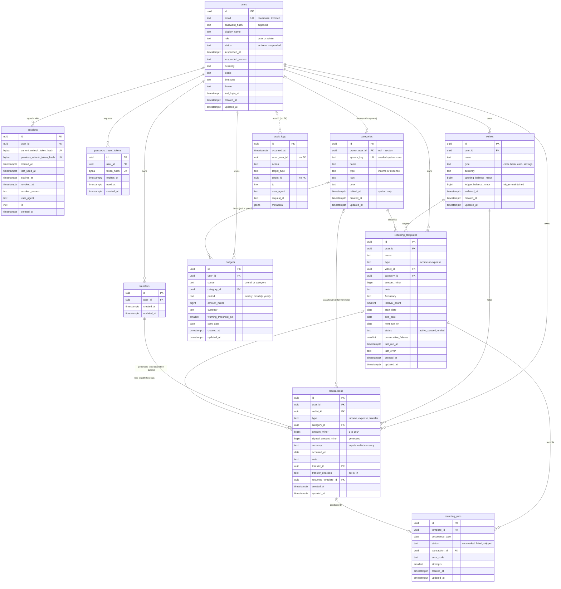

# Midas Database Design

**Status:** Accepted (baseline v1). This document resolves ADR-016.
**Owner:** db-agent
**Last updated:** 2026-10-17 (E3-F1-S1, E4-F1-S1, E5-F1-S1 implementation notes in §3.1 and §7.8)
**Related:** [Architecture](./architecture.md) (§8 requirements, §14 decision log) · [API contract](./api-contract.md)

This is the authoritative reference for Midas persistence: engine, data-access tooling, the physical schema, indexes, consistency mechanisms, migrations, seeds, backups and local setup. Backend services consume this plan. Schema changes must follow §11 and be reviewed by db-agent.

The DDL in this document is a **reference specification**. It shows the intended target schema so that migrations, reviews and tests have one source to check against. It is not itself a migration. Migrations under `apps/api/db/migrations/` implement it (§11).

---

## Contents

1. [Decision summary](#1-decision-summary)
2. [Engine decision (ADR-016 resolution)](#2-engine-decision-adr-016-resolution)
3. [Data-access and migration tooling](#3-data-access-and-migration-tooling)
4. [Conventions](#4-conventions)
5. [Money handling](#5-money-handling)
6. [Entity model and ER diagram](#6-entity-model-and-er-diagram)
7. [Table specifications](#7-table-specifications)
8. [Indexes mapped to access patterns (AP-01..AP-18)](#8-indexes-mapped-to-access-patterns-ap-01ap-18)
9. [Consistency rules (C-01..C-10)](#9-consistency-rules-c-01c-10)
10. [Soft delete, audit fields, privacy and retention](#10-soft-delete-audit-fields-privacy-and-retention)
11. [Migration strategy](#11-migration-strategy)
12. [Seeding](#12-seeding)
13. [Roles, connections and security](#13-roles-connections-and-security)
14. [Backup and restore](#14-backup-and-restore)
15. [Docker and environment variables](#15-docker-and-environment-variables)
16. [Test data and database testing](#16-test-data-and-database-testing)
17. [Story coverage](#17-story-coverage)
18. [Database decision log](#18-database-decision-log)
19. [Risks and open items](#19-risks-and-open-items)

---

## 1. Decision summary

| Topic | Decision |
| --- | --- |
| Engine | **PostgreSQL 17** (single primary, no read replicas in v1). The schema avoids version-18-only features, so a later major upgrade is purely an operations task. |
| Query layer | **Kysely** (type-safe SQL query builder) on the **`pg`** (node-postgres) driver, with `CamelCasePlugin`. Raw SQL through the Kysely `sql` tag for reports and keyset pagination. |
| Types | Generated from the migrated database with **kysely-codegen**, committed, drift-checked in CI. Enum-like columns are narrowed to `packages/shared` enums in a thin hand-written layer. |
| Migrations | **node-pg-migrate**: TypeScript files with mandatory `up` and `down`, SQL-first (`pgm.sql`), one transaction per migration by default, `noTransaction` only for `CREATE INDEX CONCURRENTLY`. Advisory-locked so concurrent deploys cannot run migrations twice. |
| Seeds | Separate from migrations: `seed:system` (idempotent system categories), `seed:dev` (demo data), `seed:perf` (100k transactions for one user, 50k users). |
| IDs | UUID primary keys, generated by the application as **UUIDv7** (time-ordered). Database default `gen_random_uuid()` as a fallback for manual SQL. |
| Time | `timestamptz(3)` (millisecond precision, UTC session) for system timestamps; `date` for ledger dates. |
| Money | `bigint` minor units, suffix `_minor`, with an adjacent `currency` column. Range checks in the database. No floating point or `numeric` columns. |
| Balances | Stored per wallet (`ledger_balance_minor`), maintained by a database trigger on `transactions` in the same transaction as the write. Balance = `opening_balance_minor + ledger_balance_minor`. |
| Enums | `text` columns with named `CHECK` constraints (not native `ENUM` types), so values can be added and removed with ordinary migrations. |
| Tenancy | Shared schema, `user_id` on every owned row, composite foreign keys that keep child rows inside the same user, plus repository scoping. Row-level security deferred (§18). |
| Search | `pg_trgm` and `btree_gin` GIN indexes for case-insensitive substring search on notes and in admin user search. |
| Concurrency | READ COMMITTED, row locks, `FOR UPDATE SKIP LOCKED` for the scheduler, transaction-scoped advisory locks for per-user limits and the admin set, unique constraints as the final guard. |
| Audit immutability | The application role has only `SELECT, INSERT` on `audit_logs`; a trigger rejects updates and non-maintenance deletes. |
| Cache / key-value | None in v1. When scaling past one instance, use a managed Redis-compatible store for rate-limit counters only (§13.6). |

---

## 2. Engine decision (ADR-016 resolution)

### 2.1 Decision

PostgreSQL 17 is the system of record for all Midas data. It is pinned to major version 17 in Docker Compose, CI and Testcontainers. Production uses any managed PostgreSQL 17 offering with automated backups and point-in-time recovery (PITR).

### 2.2 Requirement fit (architecture §8.1)

| Requirement | PostgreSQL 17 capability used |
| --- | --- |
| Multi-row ACID, row locks | MVCC, READ COMMITTED, `SELECT … FOR UPDATE / FOR NO KEY UPDATE` |
| Concurrent work claiming | `FOR UPDATE SKIP LOCKED`, `pg_advisory_xact_lock` |
| Partial and conditional uniqueness | Partial unique indexes, expression indexes on `lower(name)`, `UNIQUE … NULLS NOT DISTINCT` (15+) |
| Cross-row invariants | Deferrable constraint triggers (transfer pairs), composite foreign keys, `ON DELETE SET NULL (column)` (15+) |
| 64-bit money, dates, UTC timestamps | `bigint`, `date`, `timestamptz(3)` |
| Semi-structured audit metadata | `jsonb` with `CHECK` on shape and size |
| Case-insensitive substring search | `pg_trgm` GIN indexes (a trusted extension, available on all mainstream managed hosts) |
| Up and down migrations | Transactional DDL: a failed migration rolls back completely |
| Raw SQL for reports and keyset pagination | Row-value comparisons `(a, b, c) < ($1, $2, $3)`, `date_trunc`, `generate_series`, covering indexes with `INCLUDE` |
| Managed offerings with PITR | Available from every common container host and cloud |

### 2.3 Alternatives considered

| Option | Why not |
| --- | --- |
| **PostgreSQL 18** | Viable and newer (native `uuidv7()`, asynchronous I/O, skip scan). Not chosen as the baseline because 17 has the longer track record across managed hosts and matches the Compose and CI placeholders already planned. Nothing here depends on 17-only behavior, so upgrading is an operations change (§14.5). UUIDv7 is generated in the application, so `uuidv7()` is not needed. |
| **MySQL 8.4 LTS** | No partial indexes (needs generated-column workarounds for "unique among active rows"), no `NULLS NOT DISTINCT`, no deferrable constraints or constraint triggers for the two-leg transfer invariant, non-transactional DDL (a failed migration leaves a half-applied schema, which weakens down migrations), and no trigram GIN indexing for substring search. |
| **SQLite** | Single writer, no row-level locks or `SKIP LOCKED`, so multi-instance scheduling is unsafe. No managed PITR on mainstream container hosts. Good for embedded tools, wrong for a hosted multi-user service. |
| **MongoDB** | Ledger data is relational (wallets, categories, transfers, budgets and templates reference each other) and needs cross-document atomicity, conditional uniqueness and referential integrity that would move into application code. |
| **Distributed SQL (CockroachDB, YugabyteDB)** | Built for multi-region scale that Midas does not have. Higher cost and operational complexity, with some differences in locking semantics. |

### 2.4 Consequences

- One database serves every v1 workload: OLTP, reporting aggregations, audit and scheduling. No search engine, warehouse or queue is introduced.
- PostgreSQL 17 is supported until November 2029. A major upgrade is planned well before then.
- Migrations may use PostgreSQL-specific DDL freely. Portability to another engine is explicitly not a goal.

---

## 3. Data-access and migration tooling

### 3.1 Decision

| Concern | Tool | Notes |
| --- | --- | --- |
| Driver | `pg` (node-postgres) with `pg-cursor` | Mature, pure JavaScript (no native build in the Docker image), supports server-side cursors for the streamed CSV export. |
| Query builder | `kysely` with `PostgresDialect` and `CamelCasePlugin` | Fully typed SQL, explicit joins, `forUpdate().skipLocked()`, `onConflict`, transactions, `.stream()`. The `sql` template tag is the escape hatch for reports and row-value keyset predicates, and it is still parameterized. |
| Types | `kysely-codegen --dialect postgres --camel-case` | Generates `apps/api/src/platform/db/database.generated.ts` from a migrated database. Committed. CI fails if regenerating produces a diff. `apps/api/.kysely-codegenrc.json` sets `dateParser: string`, `numericParser: number` and `typeMapping: { int8: number }`, so the generated types match the driver mapping in §3.4. |
| Enum narrowing | Hand-written `apps/api/src/platform/db/database.ts` | Wraps the generated interface and narrows `text` enum columns to the unions exported by `packages/shared` (for example `type: TransactionType`). A parity test (§16.4) asserts that every `CHECK … IN (…)` list matches the shared enum. It also makes database-maintained columns read-only for the application (`wallets.ledger_balance_minor`, `transactions.signed_amount_minor`) and makes `categories.type` and `categories.owner_user_id` non-updatable. |
| Migrations | `node-pg-migrate` | TypeScript migration files, `up` and `down`, a transaction per migration, `pgm.noTransaction()` for concurrent index builds, an advisory lock against concurrent runners, and order checking. Migrations are written as SQL through `pgm.sql()` so reviewers see exactly the DDL that runs. |
| Seeds | Plain TypeScript modules run by the API CLI | Use the same Kysely instance and the shared validation (icon and color allowlists). |

Use the latest stable major of each package at scaffold time and pin it through `pnpm-lock.yaml`.

### 3.2 Why this combination

The schema's source of truth is the SQL in the migrations, and types are derived from the database those migrations produce. Nothing defines the schema twice, so an ORM model file cannot drift from the real constraints. That matters because much of Midas's correctness lives in database features that model-first ORMs either cannot express or express poorly: partial unique indexes, `NULLS NOT DISTINCT`, composite foreign keys, constraint triggers, generated columns, `INCLUDE` indexes and `SKIP LOCKED`.

| Option | Assessment |
| --- | --- |
| **Kysely + node-pg-migrate (selected)** | Typed queries without hiding SQL; one schema source (migrations); real up and down migrations; concurrent index builds; streaming; fits the repository layer in architecture §2.2 (repositories own SQL, services own transactions). |
| Prisma | Migrations are forward-only (no down migrations, which the E1-F2-S3 acceptance criteria require). Partial indexes, constraint triggers and generated columns need hand-edited SQL that the schema file cannot represent, causing drift warnings. No server-side cursor streaming. |
| Drizzle ORM + drizzle-kit | A pleasant TypeScript schema and query API, but drizzle-kit migrations are forward-only, and triggers and constraint triggers sit outside its schema model. Using Drizzle queries with separate SQL migrations would define the schema twice. |
| TypeORM / MikroORM | Decorator or unit-of-work models, weaker type inference for ad-hoc SQL, and migration generators that are hard to review for the constraints Midas relies on. Heavier than a modular monolith with explicit repositories needs. |
| Knex | Similar shape to Kysely, but weak TypeScript typing of results. |

### 3.3 Repository rules (for backend agents)

- Repositories receive a `Kysely<Database>` or `Transaction<Database>` handle. Services open transactions with a shared `withTransaction(db, fn, { retries })` helper and pass the handle down. Repositories never open their own transactions.
- Every query on user-owned tables includes `where user_id = :userId`, or joins from a row that does. No repository method lists another user's financial rows. Admin modules query only `users`, `sessions` (counts), `categories` (system rows) and `audit_logs`, plus platform-wide counts.
- `withTransaction` retries on `40P01` (deadlock) and `40001` (serialization failure) up to 3 times with jittered backoff. Other errors propagate.
- Unique, foreign-key and check violations are translated to Problem Details by constraint name using §7.12. Raw database messages never reach clients.
- Business timestamps (`expires_at`, `revoked_at`, `suspended_at`, `used_at`, `last_run_at`, `last_login_at`, audit `occurred_at`) are passed in from the injected `Clock`, and comparisons use a `:now` parameter instead of SQL `now()`. This keeps time-travel tests and `CLOCK_OVERRIDE` correct. `created_at` and `updated_at` use database defaults.

### 3.4 Driver type mapping

Configured once in `apps/api/src/platform/db/pg-types.ts`:

| PostgreSQL type (OID) | JavaScript value | Rule |
| --- | --- | --- |
| `int8` / `bigint` (20) | `number` | Parsed with a guard that throws `UnsafeIntegerError` outside `Number.MAX_SAFE_INTEGER`. Never parsed to a float silently. `COUNT(*)` also arrives as `int8`. |
| `numeric` (1700) | `number` | Same guard, and the value must be an integer. Aggregates should cast `SUM(...)::bigint` explicitly; the guard catches anything missed. |
| `date` (1082) | `string` (`YYYY-MM-DD`) | Returned verbatim. Never converted to `Date`, which would shift it by timezone. |
| `timestamptz` (1184) | `Date` | Serialized with `toISOString()`. Millisecond precision matches `timestamptz(3)`, so cursor values round-trip exactly. |
| `jsonb` | object | Default parser. |
| `bytea` | `Buffer` | Token hashes. |
| `inet` | `string` | |
| `uuid` | `string` | |

Every connection sets `TimeZone=UTC` (connection option `-c TimeZone=UTC`, or `SET TIME ZONE 'UTC'` in the pool `connect` hook).

---

## 4. Conventions

These satisfy the E1-F2-S3 acceptance criterion for naming, id, timestamp and money-column conventions.

### 4.1 Naming

| Object | Convention | Example |
| --- | --- | --- |
| Tables | `snake_case`, plural | `recurring_templates` |
| Columns | `snake_case`; TypeScript sees `camelCase` through `CamelCasePlugin` | `occurred_on` → `occurredOn` |
| Foreign key columns | `<referenced_singular>_id` | `wallet_id`, `owner_user_id` |
| State flags | Nullable timestamps rather than booleans where history matters | `archived_at` instead of `is_archived` |
| Primary key | `pk_<table>` | `pk_wallets` |
| Foreign key | `fk_<table>__<target>` | `fk_transactions__wallet` |
| Unique constraint or index | `uq_<table>__<columns or meaning>` | `uq_wallets__user_name_active` |
| Check constraint | `ck_<table>__<rule>` | `ck_transactions__amount_range` |
| Index | `ix_<table>__<columns or purpose>` | `ix_transactions__user_date` |
| Trigger | `tg_<table>__<purpose>`; constraint triggers `ct_<table>__<purpose>` | `tg_transactions__wallet_balance` |
| Functions | `<verb>_<object>` | `apply_wallet_balance()` |

All names stay under PostgreSQL's 63-byte identifier limit. Constraint names are part of the error-mapping contract (§7.12) and must not be renamed casually.

### 4.2 Identifiers

- Primary keys are `uuid`, generated in the application as UUIDv7 (`v7()` from the `uuid` package). This gives index locality comparable to sequential keys and roughly creation-ordered ids.
- The column default `gen_random_uuid()` exists only so manual SQL and fixtures can omit ids.
- No sequences or serial columns. Ids are exposed in the API as UUID strings.
- UUIDv7 embeds a creation timestamp. That is acceptable: ids are shown only to their owner, and admin-visible ids (users, sessions, categories) already have visible `createdAt` values.

### 4.3 Timestamps and dates

| Kind | Type | Rule |
| --- | --- | --- |
| System timestamps | `timestamptz(3)` | UTC session timezone; millisecond precision so JavaScript `Date` round-trips exactly (important for keyset cursors on `created_at`). |
| `created_at` | `timestamptz(3) NOT NULL DEFAULT now()` | On every table. |
| `updated_at` | `timestamptz(3) NOT NULL DEFAULT now()` | On every mutable table, maintained by the shared `set_updated_at()` trigger. Exceptions: `sessions` (uses `rotated_at`, `last_used_at`, `revoked_at`), and the immutable `password_reset_tokens` and `audit_logs`. |
| Ledger dates | `date` | `occurred_on`, `start_date`, `end_date`, `next_run_on`, `occurrence_date`. Checked to lie within 1900-01-01..2100-12-31 (the contract `LocalDate` range). |

### 4.4 Text

- Lengths are enforced with `CHECK (char_length(col) BETWEEN …)` on `text` columns rather than `varchar(n)`, so limits can change without a type rewrite.
- Names are trimmed by the application, and the database checks `col = btrim(col)` so stray whitespace cannot create near-duplicate names.
- Empty optional strings are stored as `NULL` (the API sends `null` to clear). Checks reject empty strings in nullable text columns.

### 4.5 Enum-like values

Stored as `text` with `CHECK (col IN (…))`. Values match the `packages/shared` enums exactly. To add or remove a value, follow §11.5.

### 4.6 Money

`bigint` columns with the suffix `_minor`, always next to a `currency` column on the same row, or on a row that a foreign key forces to match. Full rules are in §5.

---

## 5. Money handling

1. **Integer minor units only.** Every monetary column is a `bigint` named `*_minor`. There are no `real`, `double precision`, `numeric` or `money` columns.
2. **Ranges enforced in the database.**
   - Positive amounts (`transactions.amount_minor`, `budgets.amount_minor`, `recurring_templates.amount_minor`): `BETWEEN 1 AND 100000000000000` (10^14).
   - Signed amounts (`wallets.opening_balance_minor`): `BETWEEN -100000000000000 AND 100000000000000`.
   - The wallet balance (`opening_balance_minor + ledger_balance_minor`) is checked to stay within ±10^14, so `balanceMinor` always fits `SignedAmountMinor` and the JavaScript safe-integer range (see §19, item 1).
3. **Direction comes from type.** Transaction amounts are positive. `transactions.signed_amount_minor` is a stored generated column: positive for `income` and transfer `in`, negative for `expense` and transfer `out`. Balances and aggregations sum that column, so the sign rule exists in exactly one place.
4. **Currency on every money row.** `currency` is `text` checked against `^[A-Z]{3}$`. The supported list and each currency's exponent live in `packages/shared` (static ISO 4217 data), not in a database table. Removing a currency from the supported list never invalidates stored rows.
5. **A transaction's currency is its wallet's currency, enforced by a foreign key.** `transactions (wallet_id, user_id, currency)` references `wallets (id, user_id, currency)` with `ON UPDATE RESTRICT`. The database therefore rejects changing a wallet's currency while any transaction exists (`WALLET_CURRENCY_LOCKED`), not only the service.
6. **Cross-currency transfers** are two legs, each holding its own wallet's currency and amount. The implied rate is never stored. When both legs share a currency, the transfer-pair constraint trigger requires equal amounts.
7. **Aggregation rules.**
   - Never sum across currencies: every aggregate either filters `currency = :currency` or groups by `currency`.
   - Cast sums explicitly: `SUM(signed_amount_minor)::bigint`. Overflow raises `22003 numeric_value_out_of_range` instead of wrapping. The driver guard (§3.4) rejects any value beyond 2^53 − 1.
   - Percentages and budget states are computed in `packages/shared` with integer math from the integer sums.
8. **No formatting in SQL.** CSV major-unit decimals and UI formatting use the shared currency exponent table.

---

## 6. Entity model and ER diagram

### 6.1 Entities

| Table | Purpose | Owner scope | Story |
| --- | --- | --- | --- |
| `users` | Accounts, role, status, preferences | Self | E2-F1-S1 (role and status verified by E9-F1-S1) |
| `sessions` | One row per sign-in, with rotating refresh-token hashes | User | E2-F1-S1 |
| `password_reset_tokens` | Hashed single-use reset tokens | User | E2-F1-S1 |
| `wallets` | Cash, bank, card and savings accounts with a stored ledger balance | User | E3-F1-S1 |
| `categories` | System categories (owner null) and user categories | System or user | E4-F1-S1 |
| `transfers` | Header that groups the two legs of a transfer | User | E5-F1-S1 |
| `transactions` | Ledger rows: income, expense, transfer legs | User | E5-F1-S1 |
| `budgets` | Overall or per-category limits per period and currency | User | E6-F1-S1 |
| `recurring_templates` | Scheduled income and expense templates | User | E8-F1-S1 |
| `recurring_runs` | Run history, unique per template and occurrence date | User (through the template) | E8-F1-S1 |
| `audit_logs` | Append-only security and admin trail | Platform | E9-F1-S1 |

### 6.2 ER diagram



### 6.3 Relationship decisions

| Relationship | Decision | Reason |
| --- | --- | --- |
| Child rows to their user | Composite foreign keys that include `user_id` (for example `transactions (wallet_id, user_id, currency) → wallets (id, user_id, currency)`) | The database guarantees a transaction can never point at another user's wallet, transfer or template, independent of service code. |
| Category accessibility | `BEFORE INSERT OR UPDATE` trigger `assert_category_accessible()` on `transactions`, `recurring_templates` and `budgets` | A category may be a system category (owner null) or the row owner's. A plain foreign key cannot express "null owner or same owner". Cost: one primary-key lookup per write. |
| Category type match | Composite foreign key `(category_id, type) → categories (id, type)` on `transactions` and `recurring_templates` | Income rows can only use income categories. Transfers have `category_id` null, so the key is not checked (MATCH SIMPLE). Budgets (expense only) are checked in the service because a budget has no type column. |
| Transfer grouping | `transfers` header plus `transactions.transfer_id`, unique per `(transfer_id, transfer_direction)` | Avoids circular foreign keys between header and legs. Deleting the header cascades to both legs (C-01). A deferred constraint trigger enforces "both legs or neither". |
| Template link on transactions | `ON DELETE SET NULL (recurring_template_id)` | Deleting a template keeps the generated transactions and clears only the link column. The PostgreSQL 15+ column-list form leaves `user_id` intact. |
| Runs to transactions | `recurring_runs.transaction_id → transactions ON DELETE SET NULL` | Deleting a generated transaction keeps its run row, so the occurrence is not regenerated. |
| Runs to template | `ON DELETE CASCADE` | Run history belongs to the template. |
| Wallets and categories referenced by ledger rows | `ON DELETE RESTRICT` | C-09. Services check first to return friendly errors; the key is the backstop. |
| Audit log | No foreign keys | Audit rows are a historical record that must not depend on referenced rows, and targets are polymorphic. The actor's email is joined from `users` at read time. |
| Polymorphism | Only in `audit_logs.target_type` / `target_id` | Accepted there because the audit log is read-only history with nothing depending on its integrity. |

---

## 7. Table specifications

Each subsection gives the reference DDL followed by notes. Index definitions are listed with their table and mapped to access patterns in §8. The DDL shows the final v1 state; migration boundaries and creation order (functions before the triggers that use them, `recurring_templates` before the foreign key that references it) are in §11.2.

### 7.1 Extensions and shared functions

```sql
CREATE EXTENSION IF NOT EXISTS pg_trgm;    -- trigram GIN for ILIKE '%…%'
CREATE EXTENSION IF NOT EXISTS btree_gin;  -- lets uuid columns join a trigram GIN index

-- Maintains updated_at on every mutable table.
CREATE FUNCTION set_updated_at() RETURNS trigger LANGUAGE plpgsql AS $$
BEGIN
  NEW.updated_at := now();
  RETURN NEW;
END $$;
```

Both extensions are "trusted" in PostgreSQL 13+, so a database owner can create them without superuser rights on managed hosts. `gen_random_uuid()` is built in, so `pgcrypto` is not needed.

### 7.2 `users`

```sql
CREATE TABLE users (
  id               uuid           NOT NULL DEFAULT gen_random_uuid(),
  email            text           NOT NULL,
  password_hash    text           NOT NULL,
  display_name     text           NOT NULL,
  role             text           NOT NULL DEFAULT 'user',
  status           text           NOT NULL DEFAULT 'active',
  suspended_at     timestamptz(3) NULL,
  suspended_reason text           NULL,
  currency         text           NOT NULL DEFAULT 'USD',
  locale           text           NOT NULL DEFAULT 'en-US',
  timezone         text           NOT NULL DEFAULT 'UTC',
  theme            text           NOT NULL DEFAULT 'system',
  last_login_at    timestamptz(3) NULL,
  created_at       timestamptz(3) NOT NULL DEFAULT now(),
  updated_at       timestamptz(3) NOT NULL DEFAULT now(),
  CONSTRAINT pk_users PRIMARY KEY (id),
  CONSTRAINT ck_users__email_normalized CHECK (email = lower(btrim(email)) AND char_length(email) BETWEEN 3 AND 254 AND position('@' IN email) > 1),
  CONSTRAINT ck_users__password_hash CHECK (password_hash LIKE '$argon2id$%'),
  CONSTRAINT ck_users__display_name CHECK (display_name = btrim(display_name) AND char_length(display_name) BETWEEN 1 AND 80),
  CONSTRAINT ck_users__role CHECK (role IN ('user', 'admin')),
  CONSTRAINT ck_users__status CHECK (status IN ('active', 'suspended')),
  CONSTRAINT ck_users__suspension CHECK (
    (status = 'suspended') = (suspended_at IS NOT NULL)
    AND (status = 'suspended' OR suspended_reason IS NULL)
    AND (suspended_reason IS NULL OR char_length(suspended_reason) BETWEEN 1 AND 500)),
  CONSTRAINT ck_users__currency CHECK (currency ~ '^[A-Z]{3}$'),
  CONSTRAINT ck_users__locale CHECK (char_length(locale) BETWEEN 2 AND 35),
  CONSTRAINT ck_users__timezone CHECK (char_length(timezone) BETWEEN 1 AND 64),
  CONSTRAINT ck_users__theme CHECK (theme IN ('light', 'dark', 'system'))
);
CREATE UNIQUE INDEX uq_users__email          ON users (email);
CREATE INDEX ix_users__created_at            ON users (created_at, id);
CREATE INDEX ix_users__last_login_at         ON users (last_login_at DESC NULLS LAST, id);
CREATE INDEX ix_users__active_admins         ON users (id) WHERE role = 'admin' AND status = 'active';
CREATE INDEX ix_users__email_trgm            ON users USING gin (email gin_trgm_ops);
CREATE INDEX ix_users__display_name_trgm     ON users USING gin (display_name gin_trgm_ops);
CREATE TRIGGER tg_users__updated_at BEFORE UPDATE ON users FOR EACH ROW EXECUTE FUNCTION set_updated_at();
```

Notes:

- Email is normalized (trimmed, lowercased) by the application. The check guarantees that, so a plain unique index gives case-insensitive uniqueness (AP-01) without `citext` or an expression index.
- `currency`, `locale` and `timezone` are validated against the shared supported lists and `Intl` by the application. The database checks only shape, because the lists can grow without a migration.
- No account deletion in v1, so every foreign key to `users` is `RESTRICT`. A future erasure feature needs its own migration and runbook (§10.4).
- PII: `email`, `display_name`, `password_hash` (secret). See §10.3.

### 7.3 `sessions`

```sql
CREATE TABLE sessions (
  id                          uuid           NOT NULL DEFAULT gen_random_uuid(),
  user_id                     uuid           NOT NULL,
  current_refresh_token_hash  bytea          NOT NULL,
  previous_refresh_token_hash bytea          NULL,
  rotated_at                  timestamptz(3) NULL,
  created_at                  timestamptz(3) NOT NULL DEFAULT now(),
  last_used_at                timestamptz(3) NOT NULL DEFAULT now(),
  expires_at                  timestamptz(3) NOT NULL,
  revoked_at                  timestamptz(3) NULL,
  revoked_reason              text           NULL,
  user_agent                  text           NULL,
  ip                          inet           NULL,
  CONSTRAINT pk_sessions PRIMARY KEY (id),
  CONSTRAINT fk_sessions__user FOREIGN KEY (user_id) REFERENCES users (id) ON DELETE RESTRICT,
  CONSTRAINT ck_sessions__hash_length CHECK (octet_length(current_refresh_token_hash) = 32
    AND (previous_refresh_token_hash IS NULL OR octet_length(previous_refresh_token_hash) = 32)),
  CONSTRAINT ck_sessions__rotation CHECK ((previous_refresh_token_hash IS NULL) = (rotated_at IS NULL)),
  CONSTRAINT ck_sessions__expiry CHECK (expires_at > created_at),
  CONSTRAINT ck_sessions__revocation CHECK ((revoked_at IS NULL) = (revoked_reason IS NULL)),
  CONSTRAINT ck_sessions__revoked_reason CHECK (revoked_reason IN
    ('logout', 'password_changed', 'password_reset', 'suspended', 'reuse_detected')),
  CONSTRAINT ck_sessions__user_agent CHECK (user_agent IS NULL OR char_length(user_agent) <= 512)
);
CREATE UNIQUE INDEX uq_sessions__current_hash  ON sessions (current_refresh_token_hash);
CREATE UNIQUE INDEX uq_sessions__previous_hash ON sessions (previous_refresh_token_hash) WHERE previous_refresh_token_hash IS NOT NULL;
CREATE INDEX ix_sessions__user_active          ON sessions (user_id) WHERE revoked_at IS NULL;
CREATE INDEX ix_sessions__expires_at           ON sessions (expires_at);
CREATE INDEX ix_sessions__revoked_at           ON sessions (revoked_at) WHERE revoked_at IS NOT NULL;
```

Notes:

- Refresh tokens are 32 random bytes; only their SHA-256 digest is stored (`bytea`, 32 bytes). The raw token never touches the database.
- `ip` and `user_agent` are captured at sign-in only (PII, §10.3).
- `last_used_at` is updated on refresh, never on ordinary authenticated requests. The per-request auth check (AP-02) is read-only.
- `ix_sessions__user_active` serves revoke-all (C-08) and `activeSessionCount` for the admin user detail. That count also filters `expires_at > :now`.

### 7.4 `password_reset_tokens`

```sql
CREATE TABLE password_reset_tokens (
  id         uuid           NOT NULL DEFAULT gen_random_uuid(),
  user_id    uuid           NOT NULL,
  token_hash bytea          NOT NULL,
  expires_at timestamptz(3) NOT NULL,
  used_at    timestamptz(3) NULL,
  created_at timestamptz(3) NOT NULL DEFAULT now(),
  CONSTRAINT pk_password_reset_tokens PRIMARY KEY (id),
  CONSTRAINT fk_password_reset_tokens__user FOREIGN KEY (user_id) REFERENCES users (id) ON DELETE RESTRICT,
  CONSTRAINT ck_password_reset_tokens__hash_length CHECK (octet_length(token_hash) = 32),
  CONSTRAINT ck_password_reset_tokens__expiry CHECK (expires_at > created_at)
);
CREATE UNIQUE INDEX uq_password_reset_tokens__token_hash       ON password_reset_tokens (token_hash);
CREATE UNIQUE INDEX uq_password_reset_tokens__user_outstanding ON password_reset_tokens (user_id) WHERE used_at IS NULL;
CREATE INDEX ix_password_reset_tokens__expires_at              ON password_reset_tokens (expires_at);
```

Notes:

- "Issuing a new token invalidates earlier unused ones" is implemented by deleting the user's outstanding tokens and inserting the new one in one transaction. The partial unique index guarantees at most one outstanding token per user even under concurrent requests. A concurrent loser gets `23505` on `uq_password_reset_tokens__user_outstanding`; the service ignores it, because the endpoint always returns 202.
- Consumption is a single atomic statement: `UPDATE … SET used_at = :now WHERE token_hash = :h AND used_at IS NULL AND expires_at > :now RETURNING user_id`. Zero rows means `RESET_TOKEN_INVALID`.
- Verify (`/reset/verify`) is a read with the same predicate and does not consume the token.

### 7.5 `wallets`

```sql
CREATE TABLE wallets (
  id                    uuid           NOT NULL DEFAULT gen_random_uuid(),
  user_id               uuid           NOT NULL,
  name                  text           NOT NULL,
  type                  text           NOT NULL,
  currency              text           NOT NULL,
  opening_balance_minor bigint         NOT NULL DEFAULT 0,
  ledger_balance_minor  bigint         NOT NULL DEFAULT 0,
  archived_at           timestamptz(3) NULL,
  created_at            timestamptz(3) NOT NULL DEFAULT now(),
  updated_at            timestamptz(3) NOT NULL DEFAULT now(),
  CONSTRAINT pk_wallets PRIMARY KEY (id),
  CONSTRAINT fk_wallets__user FOREIGN KEY (user_id) REFERENCES users (id) ON DELETE RESTRICT,
  CONSTRAINT uq_wallets__id_user UNIQUE (id, user_id),
  CONSTRAINT uq_wallets__id_user_currency UNIQUE (id, user_id, currency),
  CONSTRAINT ck_wallets__name CHECK (name = btrim(name) AND char_length(name) BETWEEN 1 AND 60),
  CONSTRAINT ck_wallets__type CHECK (type IN ('cash', 'bank', 'card', 'savings')),
  CONSTRAINT ck_wallets__currency CHECK (currency ~ '^[A-Z]{3}$'),
  CONSTRAINT ck_wallets__opening_balance_range CHECK (opening_balance_minor BETWEEN -100000000000000 AND 100000000000000),
  CONSTRAINT ck_wallets__balance_range CHECK (opening_balance_minor + ledger_balance_minor BETWEEN -100000000000000 AND 100000000000000)
);
CREATE UNIQUE INDEX uq_wallets__user_name_active ON wallets (user_id, lower(name)) WHERE archived_at IS NULL;
CREATE INDEX ix_wallets__user_id                 ON wallets (user_id);
CREATE TRIGGER tg_wallets__updated_at
  BEFORE UPDATE OF name, type, currency, opening_balance_minor, archived_at ON wallets
  FOR EACH ROW EXECUTE FUNCTION set_updated_at();
```

Notes:

- `ledger_balance_minor` is the sum of `signed_amount_minor` of the wallet's transactions, maintained by `tg_transactions__wallet_balance` (§7.8). The API's `balanceMinor` is `opening_balance_minor + ledger_balance_minor`, so editing the opening balance never touches the ledger total.
- The `updated_at` trigger fires only for user-visible fields, so balance maintenance does not change `updatedAt`.
- Name uniqueness is case-insensitive among **active** wallets only. Unarchiving into a taken name fails on `uq_wallets__user_name_active` → `WALLET_NAME_TAKEN`, as the contract specifies.
- The two composite unique constraints exist only as foreign-key targets: `(id, user_id)` for templates and `(id, user_id, currency)` for transactions.
- The 100-per-user limit is enforced in the service under a per-user advisory lock (§9.3).
- `hasTransactions` is an `EXISTS` probe on `ix_transactions__wallet_date` (AP-18).

### 7.6 `categories`

```sql
CREATE TABLE categories (
  id            uuid           NOT NULL DEFAULT gen_random_uuid(),
  owner_user_id uuid           NULL,
  system_key    text           NULL,
  name          text           NOT NULL,
  type          text           NOT NULL,
  icon          text           NOT NULL,
  color         text           NOT NULL,
  retired_at    timestamptz(3) NULL,
  created_at    timestamptz(3) NOT NULL DEFAULT now(),
  updated_at    timestamptz(3) NOT NULL DEFAULT now(),
  CONSTRAINT pk_categories PRIMARY KEY (id),
  CONSTRAINT fk_categories__owner FOREIGN KEY (owner_user_id) REFERENCES users (id) ON DELETE RESTRICT,
  CONSTRAINT uq_categories__id_type UNIQUE (id, type),
  CONSTRAINT uq_categories__system_key UNIQUE (system_key),
  CONSTRAINT ck_categories__name CHECK (name = btrim(name) AND char_length(name) BETWEEN 1 AND 40),
  CONSTRAINT ck_categories__type CHECK (type IN ('income', 'expense')),
  CONSTRAINT ck_categories__icon CHECK (icon ~ '^[a-z0-9-]{1,40}$'),
  CONSTRAINT ck_categories__color CHECK (color ~ '^[a-z0-9-]{1,40}$'),
  CONSTRAINT ck_categories__system_only_fields CHECK (owner_user_id IS NULL OR (retired_at IS NULL AND system_key IS NULL)),
  CONSTRAINT ck_categories__system_key CHECK (system_key IS NULL OR system_key ~ '^(income|expense)[.][a-z0-9_]{1,40}$')
);
CREATE UNIQUE INDEX uq_categories__system_type_name_active ON categories (type, lower(name)) WHERE owner_user_id IS NULL AND retired_at IS NULL;
CREATE UNIQUE INDEX uq_categories__owner_type_name         ON categories (owner_user_id, type, lower(name)) WHERE owner_user_id IS NOT NULL;
CREATE INDEX ix_categories__owner_type                     ON categories (owner_user_id, type) WHERE owner_user_id IS NOT NULL;
CREATE INDEX ix_categories__system_type                    ON categories (type) WHERE owner_user_id IS NULL;
CREATE TRIGGER tg_categories__updated_at BEFORE UPDATE ON categories FOR EACH ROW EXECUTE FUNCTION set_updated_at();
CREATE TRIGGER tg_categories__owner_immutable BEFORE UPDATE OF owner_user_id ON categories
  FOR EACH ROW WHEN (OLD.owner_user_id IS DISTINCT FROM NEW.owner_user_id)
  EXECUTE FUNCTION forbid_category_owner_change();   -- raises 23514, CONSTRAINT ck_categories__owner_immutable
```

Notes:

- `owner_user_id IS NULL` means a system category; `system = (owner_user_id IS NULL)` and `retired = (retired_at IS NOT NULL)` in the API.
- `owner_user_id` is immutable. Moving a category between users, or between a user and the system, would re-scope every row that references it, and `assert_category_accessible()` only checks a reference when the referencing row is written. `tg_categories__owner_immutable` rejects the change for every role, and the Kysely type makes the column non-updatable.
- Row locks (§9.2): user requests lock only the user's own rows. `PATCH` and `DELETE` first read the row without a lock, so a request against a shared system category gets `403 SYSTEM_CATEGORY_READ_ONLY` without locking it. Rename then locks with `FOR NO KEY UPDATE` (ledger writes that reference the category are not blocked); delete locks with `FOR UPDATE` (C-05).
- System names are unique per type among non-retired system categories, so restoring into a taken name fails with `CATEGORY_NAME_TAKEN`. User names are unique per owner and type. A user category may share a name with a system category.
- `type` is immutable (contract). It must never be updated, because `uq_categories__id_type` is the target of the type-matching foreign keys (an update would be rejected by `ON UPDATE RESTRICT` anyway when referenced).
- `system_key` is a stable identifier (for example `expense.groceries`) used only by the idempotent seed (§12.1). Admin-created system categories leave it null.
- Icon and color values are checked for shape; the allowlists live in `packages/shared` and are validated by the service and the seed.
- The 200-per-user limit is enforced in the service under a per-user advisory lock.

### 7.7 `transfers`

```sql
CREATE TABLE transfers (
  id         uuid           NOT NULL DEFAULT gen_random_uuid(),
  user_id    uuid           NOT NULL,
  created_at timestamptz(3) NOT NULL DEFAULT now(),
  updated_at timestamptz(3) NOT NULL DEFAULT now(),
  CONSTRAINT pk_transfers PRIMARY KEY (id),
  CONSTRAINT fk_transfers__user FOREIGN KEY (user_id) REFERENCES users (id) ON DELETE RESTRICT,
  CONSTRAINT uq_transfers__id_user UNIQUE (id, user_id)
);
CREATE INDEX ix_transfers__user_id ON transfers (user_id);   -- FK support for fk_transfers__user
CREATE TRIGGER tg_transfers__updated_at BEFORE UPDATE ON transfers FOR EACH ROW EXECUTE FUNCTION set_updated_at();
CREATE CONSTRAINT TRIGGER ct_transfers__pair AFTER INSERT ON transfers
  DEFERRABLE INITIALLY DEFERRED FOR EACH ROW EXECUTE FUNCTION assert_transfer_pair();
```

Notes:

- The header carries identity, ownership and timestamps. `occurred_on`, `note` and amounts live on the legs, which the list, filters and reports read directly. The pair trigger keeps the shared values consistent.
- `PATCH /transfers/{id}` updates both legs and touches the header (`UPDATE transfers SET updated_at = now()`), all in one transaction.
- The header row is the lock for the whole transfer: every service writer locks it (`FOR NO KEY UPDATE`, after the wallets, §9.2), and the deferred pair check locks it too before it reads the legs.
- The API `Transfer` is assembled from the header plus both legs: `fromWallet` and `amountMinor` from the `out` leg, `toWallet` and `toAmountMinor` from the `in` leg.

### 7.8 `transactions`

```sql
CREATE TABLE transactions (
  id                    uuid           NOT NULL DEFAULT gen_random_uuid(),
  user_id               uuid           NOT NULL,
  wallet_id             uuid           NOT NULL,
  type                  text           NOT NULL,
  category_id           uuid           NULL,
  amount_minor          bigint         NOT NULL,
  signed_amount_minor   bigint         GENERATED ALWAYS AS (
                          CASE WHEN type = 'income' OR transfer_direction = 'in'
                               THEN amount_minor ELSE -amount_minor END) STORED,
  currency              text           NOT NULL,
  occurred_on           date           NOT NULL,
  note                  text           NULL,
  transfer_id           uuid           NULL,
  transfer_direction    text           NULL,
  recurring_template_id uuid           NULL,      -- added by the E8-F1-S1 migration (§11.2)
  created_at            timestamptz(3) NOT NULL DEFAULT now(),
  updated_at            timestamptz(3) NOT NULL DEFAULT now(),
  CONSTRAINT pk_transactions PRIMARY KEY (id),
  CONSTRAINT fk_transactions__user FOREIGN KEY (user_id) REFERENCES users (id) ON DELETE RESTRICT,
  CONSTRAINT fk_transactions__wallet FOREIGN KEY (wallet_id, user_id, currency)
    REFERENCES wallets (id, user_id, currency) ON DELETE RESTRICT ON UPDATE RESTRICT,
  CONSTRAINT fk_transactions__category FOREIGN KEY (category_id, type)
    REFERENCES categories (id, type) ON DELETE RESTRICT ON UPDATE RESTRICT,
  CONSTRAINT fk_transactions__transfer FOREIGN KEY (transfer_id, user_id)
    REFERENCES transfers (id, user_id) ON DELETE CASCADE,
  CONSTRAINT fk_transactions__recurring_template FOREIGN KEY (recurring_template_id, user_id)
    REFERENCES recurring_templates (id, user_id) ON DELETE SET NULL (recurring_template_id),
  CONSTRAINT ck_transactions__type CHECK (type IN ('income', 'expense', 'transfer')),
  CONSTRAINT ck_transactions__amount_range CHECK (amount_minor BETWEEN 1 AND 100000000000000),
  CONSTRAINT ck_transactions__currency CHECK (currency ~ '^[A-Z]{3}$'),
  CONSTRAINT ck_transactions__occurred_on_range CHECK (occurred_on BETWEEN DATE '1900-01-01' AND DATE '2100-12-31'),
  CONSTRAINT ck_transactions__note CHECK (note IS NULL OR char_length(note) BETWEEN 1 AND 500),
  CONSTRAINT ck_transactions__transfer_direction CHECK (transfer_direction IN ('out', 'in')),
  CONSTRAINT ck_transactions__transfer_shape CHECK (
    (type = 'transfer') = (transfer_id IS NOT NULL)
    AND (transfer_id IS NULL) = (transfer_direction IS NULL)
    AND (type = 'transfer') = (category_id IS NULL)),
  CONSTRAINT ck_transactions__recurring_type CHECK (recurring_template_id IS NULL OR type <> 'transfer')
);

-- AP-07 list (date sorts), AP-09 aggregations via index-only scans
CREATE INDEX ix_transactions__user_date ON transactions (user_id, occurred_on, created_at, id)
  INCLUDE (type, currency, category_id, amount_minor);
-- AP-07 amount sorts and amount-range filters
CREATE INDEX ix_transactions__user_amount ON transactions (user_id, amount_minor, created_at, id);
-- AP-07 wallet filter, AP-18 wallet-in-use probe, FK support for wallet delete and currency change
CREATE INDEX ix_transactions__wallet_date ON transactions (wallet_id, occurred_on, created_at, id);
-- AP-07 category filter, AP-12 in-use check and bulk reassign, FK support for category delete
CREATE INDEX ix_transactions__category_user_date ON transactions (category_id, user_id, occurred_on, created_at, id)
  WHERE category_id IS NOT NULL;
-- Exactly one out leg and one in leg per transfer; FK support for the header cascade
CREATE UNIQUE INDEX uq_transactions__transfer_leg ON transactions (transfer_id, transfer_direction)
  WHERE transfer_id IS NOT NULL;
-- FK support for template delete (SET NULL)
CREATE INDEX ix_transactions__recurring_template ON transactions (recurring_template_id)
  WHERE recurring_template_id IS NOT NULL;
-- AP-07 note substring search, scoped by user inside one GIN index
CREATE INDEX ix_transactions__user_note_trgm ON transactions USING gin (user_id, note gin_trgm_ops)
  WHERE note IS NOT NULL;
-- AP-15 "created within 30 days" (append-mostly table, so BRIN stays tiny and effective)
CREATE INDEX ix_transactions__created_at_brin ON transactions USING brin (created_at);

CREATE TRIGGER tg_transactions__updated_at BEFORE UPDATE ON transactions
  FOR EACH ROW EXECUTE FUNCTION set_updated_at();
CREATE TRIGGER tg_transactions__category_accessible BEFORE INSERT OR UPDATE OF category_id, user_id ON transactions
  FOR EACH ROW EXECUTE FUNCTION assert_category_accessible();
CREATE TRIGGER tg_transactions__wallet_balance
  AFTER INSERT OR DELETE OR UPDATE OF wallet_id, amount_minor, type, transfer_direction ON transactions
  FOR EACH ROW EXECUTE FUNCTION apply_wallet_balance();
-- The pair check only concerns transfer legs: one trigger per event, each with a WHEN filter
-- (INSERT cannot see OLD, DELETE cannot see NEW), so other rows queue no deferred events.
CREATE CONSTRAINT TRIGGER ct_transactions__transfer_pair_insert AFTER INSERT ON transactions
  DEFERRABLE INITIALLY DEFERRED FOR EACH ROW WHEN (NEW.transfer_id IS NOT NULL)
  EXECUTE FUNCTION assert_transfer_pair();
CREATE CONSTRAINT TRIGGER ct_transactions__transfer_pair_update AFTER UPDATE ON transactions
  DEFERRABLE INITIALLY DEFERRED FOR EACH ROW WHEN (OLD.transfer_id IS NOT NULL OR NEW.transfer_id IS NOT NULL)
  EXECUTE FUNCTION assert_transfer_pair();
CREATE CONSTRAINT TRIGGER ct_transactions__transfer_pair_delete AFTER DELETE ON transactions
  DEFERRABLE INITIALLY DEFERRED FOR EACH ROW WHEN (OLD.transfer_id IS NOT NULL)
  EXECUTE FUNCTION assert_transfer_pair();
```

Trigger functions (reference):

```sql
-- Keeps wallets.ledger_balance_minor equal to the sum of signed amounts (C-02).
-- An update within one wallet applies a single NEW - OLD difference and skips the wallet write
-- when the signed amount is unchanged (for example a transfer edit of only the date or note).
CREATE FUNCTION apply_wallet_balance() RETURNS trigger LANGUAGE plpgsql AS $$
BEGIN
  IF TG_OP = 'UPDATE' AND OLD.wallet_id = NEW.wallet_id THEN
    IF OLD.signed_amount_minor <> NEW.signed_amount_minor THEN
      UPDATE wallets
         SET ledger_balance_minor = ledger_balance_minor + (NEW.signed_amount_minor - OLD.signed_amount_minor)
       WHERE id = NEW.wallet_id;
    END IF;
    RETURN NULL;
  END IF;
  IF TG_OP IN ('UPDATE', 'DELETE') THEN
    UPDATE wallets SET ledger_balance_minor = ledger_balance_minor - OLD.signed_amount_minor
     WHERE id = OLD.wallet_id;
  END IF;
  IF TG_OP IN ('INSERT', 'UPDATE') THEN
    UPDATE wallets SET ledger_balance_minor = ledger_balance_minor + NEW.signed_amount_minor
     WHERE id = NEW.wallet_id;
  END IF;
  RETURN NULL;
END $$;

-- A category must be a system category or belong to the row owner (tenant isolation).
CREATE FUNCTION assert_category_accessible() RETURNS trigger LANGUAGE plpgsql AS $$
BEGIN
  IF NEW.category_id IS NOT NULL AND NOT EXISTS (
       SELECT 1 FROM categories c
        WHERE c.id = NEW.category_id
          AND (c.owner_user_id IS NULL OR c.owner_user_id = NEW.user_id)) THEN
    RAISE EXCEPTION 'category % is not accessible to user %', NEW.category_id, NEW.user_id
      USING ERRCODE = 'foreign_key_violation', CONSTRAINT = 'fk_category_accessible';
  END IF;
  RETURN NEW;
END $$;

-- At commit, each transfer has exactly an out leg and an in leg that agree (C-01),
-- or has no header and no legs. On UPDATE both the old and the new transfer are checked,
-- so moving a leg out of its transfer (for example turning it into an expense) cannot
-- leave an orphaned leg behind. The header is locked before the legs are read, so the
-- checks of two transactions that each change one leg run one after the other, and the
-- second one sees the first one's committed change.
CREATE FUNCTION assert_transfer_pair() RETURNS trigger LANGUAGE plpgsql AS $$
DECLARE
  tids uuid[];
  tid  uuid;
BEGIN
  IF TG_TABLE_NAME = 'transfers' THEN
    tids := ARRAY[NEW.id];
  ELSIF TG_OP = 'INSERT' THEN
    tids := ARRAY[NEW.transfer_id];
  ELSIF TG_OP = 'DELETE' THEN
    tids := ARRAY[OLD.transfer_id];
  ELSIF OLD.transfer_id IS NOT DISTINCT FROM NEW.transfer_id THEN
    tids := ARRAY[NEW.transfer_id];
  ELSE
    tids := ARRAY[OLD.transfer_id, NEW.transfer_id];
  END IF;

  FOREACH tid IN ARRAY tids LOOP
    CONTINUE WHEN tid IS NULL;
    PERFORM 1 FROM transfers WHERE id = tid FOR NO KEY UPDATE;
    IF NOT FOUND THEN
      IF EXISTS (SELECT 1 FROM transactions WHERE transfer_id = tid) THEN
        RAISE EXCEPTION 'transfer % has legs but no header', tid
          USING ERRCODE = 'check_violation', CONSTRAINT = 'ck_transfers__pair';
      END IF;
      CONTINUE;
    END IF;
    PERFORM 1
       FROM transactions o
       JOIN transactions i ON i.transfer_id = o.transfer_id AND i.transfer_direction = 'in'
      WHERE o.transfer_id = tid AND o.transfer_direction = 'out'
        AND o.wallet_id <> i.wallet_id
        AND o.occurred_on = i.occurred_on
        AND o.note IS NOT DISTINCT FROM i.note
        AND (o.currency <> i.currency OR o.amount_minor = i.amount_minor);
    IF NOT FOUND THEN
      RAISE EXCEPTION 'transfer % is incomplete or inconsistent', tid
        USING ERRCODE = 'check_violation', CONSTRAINT = 'ck_transfers__pair';
    END IF;
  END LOOP;
  RETURN NULL;
END $$;
```

The `OLD.transfer_id` check on UPDATE was added during E5-F1-S1 (2026-10-17). The first draft checked only `NEW.transfer_id`, so an update that detached one leg from its transfer passed.

Review fixes on 2026-10-18, made in place because the Sprint 2 migrations were not merged anywhere yet (§11.2):

- The header lock in `assert_transfer_pair()`. Without it, two transactions that each changed one leg could both pass their check (each saw the other leg unchanged) and commit an invalid pair together.
- The single-difference path in `apply_wallet_balance()`.
- The split, WHEN-filtered pair triggers (previously one unfiltered `ct_transactions__transfer_pair` that queued an event for every changed row, including bulk category reassignments).
- `ix_transfers__user_id`, `tg_categories__owner_immutable`, and the `ledger_balance_minor` reset in the down migration.

Notes:

- **Shape rules.** `category_id` is null if and only if the row is a transfer leg; `transfer_id` and `transfer_direction` are set if and only if it is a transfer leg; generated transactions are never transfers.
- **Tenant integrity.** The wallet, transfer and template foreign keys all include `user_id`. The category trigger covers the one relationship a foreign key cannot.
- **Currency lock.** Because the wallet key includes `currency` with `ON UPDATE RESTRICT`, changing a wallet's currency fails while any transaction references it (`fk_transactions__wallet` → `WALLET_CURRENCY_LOCKED`).
- **Balance trigger.** It is the only writer of `ledger_balance_minor`. It does not fire for updates that touch only `category_id`, `note` or `occurred_on`, so bulk category reassignment does not lock wallets. When it fires for an update that keeps the wallet, it writes one difference, or nothing if the signed amount did not change. Generated column values are available in `AFTER` triggers.
- **Pair trigger.** It is deferred to commit, so the service can insert the header and both legs in any order within one transaction. It fires only for transfer legs (WHEN filters). It locks the header (`FOR NO KEY UPDATE`) before reading the legs, so concurrent writers of one transfer are checked one after the other. It should never fail in normal operation, because the service validates first. If it does fail, it is a bug and maps to `500 INTERNAL_ERROR`.
- **Locking order.** Ledger writes lock the involved wallet rows first with `SELECT … FROM wallets WHERE id = ANY(:ids) ORDER BY id FOR NO KEY UPDATE`, then check `archived_at`. This serializes against archive and currency changes (no time-of-check gap) and makes transfers between the same two wallets in opposite directions take locks in the same order, which prevents deadlocks. Category key-share locks come next and ledger row locks last; edits and deletes of an existing row follow the procedure in §9.2.
- **Keyset sorts** (contract: ties broken by `created_at`, then `id`):

  | Sort | Order by | Cursor predicate | Index |
  | --- | --- | --- | --- |
  | `date_desc` | `occurred_on DESC, created_at DESC, id DESC` | `(occurred_on, created_at, id) < (:d, :c, :id)` | `ix_transactions__user_date` (backward scan) |
  | `date_asc` | `occurred_on, created_at, id` | `(occurred_on, created_at, id) > (:d, :c, :id)` | `ix_transactions__user_date` |
  | `amount_desc` | `amount_minor DESC, created_at DESC, id DESC` | `(amount_minor, created_at, id) < (:a, :c, :id)` | `ix_transactions__user_amount` (backward scan) |
  | `amount_asc` | `amount_minor, created_at, id` | `(amount_minor, created_at, id) > (:a, :c, :id)` | `ix_transactions__user_amount` |

  The cursor is an opaque base64url payload of the sort key values, the id and a hash of the filters, so a mismatched cursor returns `INVALID_CURSOR`.
- **Note search.** `q` is matched with `note ILIKE '%' || :escaped || '%'`, where the service escapes `\`, `%` and `_`. Trigram indexes help from three characters upward. One- and two-character queries fall back to the user-scoped date index, which is acceptable at 100k rows per user.
- **Filters with arrays.** `wallet_id = ANY(:walletIds)`, `category_id = ANY(:categoryIds)`, `type = ANY(:types)`. Always combined with `user_id = :userId`, even when wallet or category ids are given.

### 7.9 `budgets`

```sql
CREATE TABLE budgets (
  id                    uuid           NOT NULL DEFAULT gen_random_uuid(),
  user_id               uuid           NOT NULL,
  scope                 text           NOT NULL,
  category_id           uuid           NULL,
  period                text           NOT NULL DEFAULT 'monthly',
  amount_minor          bigint         NOT NULL,
  currency              text           NOT NULL,
  warning_threshold_pct smallint       NOT NULL DEFAULT 80,
  start_date            date           NOT NULL,
  created_at            timestamptz(3) NOT NULL DEFAULT now(),
  updated_at            timestamptz(3) NOT NULL DEFAULT now(),
  CONSTRAINT pk_budgets PRIMARY KEY (id),
  CONSTRAINT fk_budgets__user FOREIGN KEY (user_id) REFERENCES users (id) ON DELETE RESTRICT,
  CONSTRAINT fk_budgets__category FOREIGN KEY (category_id) REFERENCES categories (id) ON DELETE RESTRICT,
  CONSTRAINT ck_budgets__scope CHECK (scope IN ('overall', 'category')),
  CONSTRAINT ck_budgets__scope_shape CHECK ((scope = 'overall') = (category_id IS NULL)),
  CONSTRAINT ck_budgets__period CHECK (period IN ('weekly', 'monthly', 'yearly')),
  CONSTRAINT ck_budgets__amount_range CHECK (amount_minor BETWEEN 1 AND 100000000000000),
  CONSTRAINT ck_budgets__currency CHECK (currency ~ '^[A-Z]{3}$'),
  CONSTRAINT ck_budgets__threshold CHECK (warning_threshold_pct BETWEEN 1 AND 99),
  CONSTRAINT ck_budgets__start_date_range CHECK (start_date BETWEEN DATE '1900-01-01' AND DATE '2100-12-31'),
  CONSTRAINT ck_budgets__start_date_aligned CHECK (
       (period = 'monthly' AND extract(day FROM start_date) = 1)
    OR (period = 'yearly'  AND extract(month FROM start_date) = 1 AND extract(day FROM start_date) = 1)
    OR (period = 'weekly'  AND extract(isodow FROM start_date) = 1))
);
CREATE UNIQUE INDEX uq_budgets__user_category_period_currency
  ON budgets (user_id, category_id, period, currency) NULLS NOT DISTINCT;
CREATE INDEX ix_budgets__category_id ON budgets (category_id) WHERE category_id IS NOT NULL;
CREATE TRIGGER tg_budgets__updated_at BEFORE UPDATE ON budgets FOR EACH ROW EXECUTE FUNCTION set_updated_at();
CREATE TRIGGER tg_budgets__category_accessible BEFORE INSERT OR UPDATE OF category_id, user_id ON budgets
  FOR EACH ROW EXECUTE FUNCTION assert_category_accessible();
```

Notes:

- One budget per (user, category or overall, period, currency). `NULLS NOT DISTINCT` (PostgreSQL 15+) treats all overall budgets (null category) as equal, so a single index covers both scopes. Violation → `BUDGET_EXISTS`.
- `start_date` must already be normalized to the period start (monthly: day 1; yearly: 1 January; weekly: ISO Monday). The service normalizes; the check guarantees it.
- Spent amounts are computed on read (ADR-012), so there are no per-period rows.
- The expense-only rule for category budgets is a service check (`CATEGORY_TYPE_MISMATCH`). Tenant access is enforced by the category trigger.
- The 200-per-user limit is enforced in the service under a per-user advisory lock.

### 7.10 `recurring_templates` and `recurring_runs`

```sql
CREATE TABLE recurring_templates (
  id                   uuid           NOT NULL DEFAULT gen_random_uuid(),
  user_id              uuid           NOT NULL,
  name                 text           NOT NULL,
  type                 text           NOT NULL,
  wallet_id            uuid           NOT NULL,
  category_id          uuid           NOT NULL,
  amount_minor         bigint         NOT NULL,
  note                 text           NULL,
  frequency            text           NOT NULL,
  interval_count       smallint       NOT NULL DEFAULT 1,
  start_date           date           NOT NULL,
  end_date             date           NULL,
  next_run_on          date           NULL,
  status               text           NOT NULL DEFAULT 'active',
  consecutive_failures smallint       NOT NULL DEFAULT 0,
  last_run_at          timestamptz(3) NULL,
  last_error           text           NULL,
  created_at           timestamptz(3) NOT NULL DEFAULT now(),
  updated_at           timestamptz(3) NOT NULL DEFAULT now(),
  CONSTRAINT pk_recurring_templates PRIMARY KEY (id),
  CONSTRAINT fk_recurring_templates__user FOREIGN KEY (user_id) REFERENCES users (id) ON DELETE RESTRICT,
  CONSTRAINT fk_recurring_templates__wallet FOREIGN KEY (wallet_id, user_id)
    REFERENCES wallets (id, user_id) ON DELETE RESTRICT,
  CONSTRAINT fk_recurring_templates__category FOREIGN KEY (category_id, type)
    REFERENCES categories (id, type) ON DELETE RESTRICT ON UPDATE RESTRICT,
  CONSTRAINT uq_recurring_templates__id_user UNIQUE (id, user_id),
  CONSTRAINT ck_recurring_templates__name CHECK (name = btrim(name) AND char_length(name) BETWEEN 1 AND 60),
  CONSTRAINT ck_recurring_templates__type CHECK (type IN ('income', 'expense')),
  CONSTRAINT ck_recurring_templates__amount_range CHECK (amount_minor BETWEEN 1 AND 100000000000000),
  CONSTRAINT ck_recurring_templates__note CHECK (note IS NULL OR char_length(note) BETWEEN 1 AND 500),
  CONSTRAINT ck_recurring_templates__frequency CHECK (frequency IN ('daily', 'weekly', 'monthly', 'yearly')),
  CONSTRAINT ck_recurring_templates__interval CHECK (interval_count BETWEEN 1 AND 99),
  CONSTRAINT ck_recurring_templates__dates CHECK (
    start_date BETWEEN DATE '1900-01-01' AND DATE '2100-12-31'
    AND (end_date IS NULL OR (end_date >= start_date AND end_date <= DATE '2100-12-31'))),
  CONSTRAINT ck_recurring_templates__status CHECK (status IN ('active', 'paused', 'ended')),
  CONSTRAINT ck_recurring_templates__next_run CHECK ((status = 'ended') = (next_run_on IS NULL)),
  CONSTRAINT ck_recurring_templates__failures CHECK (consecutive_failures >= 0),
  CONSTRAINT ck_recurring_templates__last_error CHECK (last_error IS NULL OR last_error ~ '^[A-Z][A-Z0-9_]{0,63}$')
);
-- AP-10 due-template claim; also serves the "active templates" metric count
CREATE INDEX ix_recurring_templates__due         ON recurring_templates (next_run_on, id) WHERE status = 'active';
CREATE INDEX ix_recurring_templates__user_id     ON recurring_templates (user_id);
CREATE INDEX ix_recurring_templates__wallet_id   ON recurring_templates (wallet_id);
CREATE INDEX ix_recurring_templates__category_id ON recurring_templates (category_id);
CREATE TRIGGER tg_recurring_templates__updated_at BEFORE UPDATE ON recurring_templates
  FOR EACH ROW EXECUTE FUNCTION set_updated_at();
CREATE TRIGGER tg_recurring_templates__category_accessible BEFORE INSERT OR UPDATE OF category_id, user_id ON recurring_templates
  FOR EACH ROW EXECUTE FUNCTION assert_category_accessible();

CREATE TABLE recurring_runs (
  id              uuid           NOT NULL DEFAULT gen_random_uuid(),
  template_id     uuid           NOT NULL,
  occurrence_date date           NOT NULL,
  status          text           NOT NULL,
  transaction_id  uuid           NULL,
  error_code      text           NULL,
  attempts        smallint       NOT NULL DEFAULT 1,
  created_at      timestamptz(3) NOT NULL DEFAULT now(),
  updated_at      timestamptz(3) NOT NULL DEFAULT now(),
  CONSTRAINT pk_recurring_runs PRIMARY KEY (id),
  CONSTRAINT fk_recurring_runs__template FOREIGN KEY (template_id) REFERENCES recurring_templates (id) ON DELETE CASCADE,
  CONSTRAINT fk_recurring_runs__transaction FOREIGN KEY (transaction_id) REFERENCES transactions (id) ON DELETE SET NULL,
  CONSTRAINT uq_recurring_runs__template_occurrence UNIQUE (template_id, occurrence_date),
  CONSTRAINT ck_recurring_runs__status CHECK (status IN ('succeeded', 'failed', 'skipped')),
  CONSTRAINT ck_recurring_runs__transaction_shape CHECK (status = 'succeeded' OR transaction_id IS NULL),
  CONSTRAINT ck_recurring_runs__error_shape CHECK ((status = 'succeeded') = (error_code IS NULL)),
  CONSTRAINT ck_recurring_runs__error_code CHECK (error_code IS NULL OR error_code ~ '^[A-Z][A-Z0-9_]{0,63}$'),
  CONSTRAINT ck_recurring_runs__attempts CHECK (attempts >= 1)
);
CREATE UNIQUE INDEX uq_recurring_runs__transaction ON recurring_runs (transaction_id) WHERE transaction_id IS NOT NULL;
CREATE TRIGGER tg_recurring_runs__updated_at BEFORE UPDATE ON recurring_runs FOR EACH ROW EXECUTE FUNCTION set_updated_at();
```

Notes:

- `interval_count` is exposed as `interval` in the API. `interval` is avoided as a column name because it is also a SQL type keyword.
- The anchor day is not stored. It is derived from `start_date` by the shared recurrence calculator, which also applies month-end clamping.
- `next_run_on` is null only when the template has ended. Paused templates keep their last value, and resume recomputes it.
- A succeeded run may later have `transaction_id` null if the user deleted the generated transaction. The run row still blocks regeneration.
- `uq_recurring_runs__template_occurrence` is the idempotency key (AP-11). Scanned backwards, it also serves the newest-first run list for one template.
- Archiving a wallet pauses its active templates in the same transaction (`ix_recurring_templates__wallet_id`).
- The 200-per-user limit is enforced in the service under a per-user advisory lock.

### 7.11 `audit_logs`

```sql
CREATE TABLE audit_logs (
  id            uuid           NOT NULL DEFAULT gen_random_uuid(),
  occurred_at   timestamptz(3) NOT NULL DEFAULT now(),
  actor_user_id uuid           NULL,
  action        text           NOT NULL,
  target_type   text           NOT NULL,
  target_id     uuid           NULL,
  ip            inet           NULL,
  user_agent    text           NULL,
  request_id    text           NULL,
  metadata      jsonb          NOT NULL DEFAULT '{}'::jsonb,
  CONSTRAINT pk_audit_logs PRIMARY KEY (id),
  CONSTRAINT ck_audit_logs__action CHECK (action ~ '^[a-z]+\.[a-z_]+$' AND char_length(action) <= 64),
  CONSTRAINT ck_audit_logs__target_type CHECK (target_type IN ('user', 'session', 'category', 'system')),
  CONSTRAINT ck_audit_logs__user_agent CHECK (user_agent IS NULL OR char_length(user_agent) <= 512),
  CONSTRAINT ck_audit_logs__request_id CHECK (request_id IS NULL OR request_id ~ '^[A-Za-z0-9-]{8,64}$'),
  CONSTRAINT ck_audit_logs__metadata CHECK (jsonb_typeof(metadata) = 'object' AND octet_length(metadata::text) <= 4096)
);
CREATE INDEX ix_audit_logs__occurred_at        ON audit_logs (occurred_at, id);
CREATE INDEX ix_audit_logs__actor_occurred_at  ON audit_logs (actor_user_id, occurred_at, id) WHERE actor_user_id IS NOT NULL;
CREATE INDEX ix_audit_logs__target_occurred_at ON audit_logs (target_type, target_id, occurred_at, id);
CREATE INDEX ix_audit_logs__action_occurred_at ON audit_logs (action, occurred_at, id);

CREATE FUNCTION forbid_audit_mutation() RETURNS trigger LANGUAGE plpgsql AS $$
BEGIN
  IF TG_OP = 'DELETE' AND EXISTS (SELECT 1 FROM pg_roles WHERE rolname = 'midas_maintenance') THEN
    IF pg_has_role(current_user, 'midas_maintenance', 'MEMBER') THEN
      RETURN OLD;   -- retention purge (§10.5)
    END IF;
  END IF;
  RAISE EXCEPTION 'audit_logs is append-only'
    USING ERRCODE = 'insufficient_privilege';
END $$;
CREATE TRIGGER tg_audit_logs__immutable BEFORE UPDATE OR DELETE ON audit_logs
  FOR EACH ROW EXECUTE FUNCTION forbid_audit_mutation();
-- Privileges (§13.2): REVOKE UPDATE, DELETE, TRUNCATE ON audit_logs FROM midas_app;
```

Notes:

- `action` is validated against the shared `AuditAction` list by the service. The database checks only the format, so new actions do not need a migration.
- `metadata` never contains passwords, tokens, amounts, notes or transaction details (ADR-018). Failed logins for unknown emails store an HMAC of the email, never the plain email. The 4 KB cap stops accidental large payloads.
- `actorEmail` filters are resolved to an `actor_user_id` through `uq_users__email` first, then use the actor index.
- Date filters are UTC days: `occurred_at >= :from::date AND occurred_at < (:to::date + 1)`.
- Keyset order is `occurred_at DESC, id DESC` with the predicate `(occurred_at, id) < (:t, :id)`.
- At 5M rows the btree indexes meet AP-14. Monthly range partitioning is the documented next step if the table grows past about 50M rows (it makes retention a cheap `DROP PARTITION`). It is not needed in v1.

### 7.12 Constraint-to-error mapping

Services translate database errors by SQLSTATE and constraint name. Anything not listed maps to `500 INTERNAL_ERROR` and is logged with the constraint name (never returned to the client).

| Constraint | SQLSTATE | API error |
| --- | --- | --- |
| `uq_users__email` | 23505 | 409 `EMAIL_TAKEN` |
| `uq_wallets__user_name_active` | 23505 | 409 `WALLET_NAME_TAKEN` |
| `fk_transactions__wallet` on wallet currency update | 23503 | 409 `WALLET_CURRENCY_LOCKED` |
| `fk_transactions__wallet`, `fk_recurring_templates__wallet` on wallet delete | 23503 | 409 `WALLET_IN_USE` |
| `uq_categories__system_type_name_active`, `uq_categories__owner_type_name` | 23505 | 409 `CATEGORY_NAME_TAKEN` |
| `fk_transactions__category`, `fk_recurring_templates__category`, `fk_budgets__category` on category delete | 23503 | 409 `CATEGORY_IN_USE` |
| `fk_transactions__category` on a ledger insert or update | 23503 | 422 `INVALID_REFERENCE` (field `categoryId`). The service checks the type first and `categories.type` is immutable, so this key can only fail because the category vanished. A type mismatch is answered by the service as 422 `CATEGORY_TYPE_MISMATCH` before any write. |
| `fk_recurring_templates__category` on insert or update | 23503 | Decided with E8 (same reasoning as the row above) |
| `fk_category_accessible` (trigger) | 23503 | 422 `INVALID_REFERENCE` (field `categoryId`) |
| `ck_categories__owner_immutable` (trigger) | 23514 | 500 `INTERNAL_ERROR` (no API changes the owner; a hit is a bug) |
| `uq_budgets__user_category_period_currency` | 23505 | 409 `BUDGET_EXISTS` |
| `uq_recurring_runs__template_occurrence` | 23505 | Not an error: the occurrence already exists, so the scheduler skips it |
| `uq_password_reset_tokens__user_outstanding` | 23505 | Not an error: the endpoint still returns 202 |
| `fk_transactions__wallet`, `fk_recurring_templates__wallet` on insert or update (wallet missing, another user's, or currency mismatch) | 23503 | 422 `INVALID_REFERENCE` (field `walletId`) |
| `ck_wallets__balance_range` | 23514 | Pending an architect decision (§19, item 1); until then 400 `VALIDATION_FAILED` with field `amountMinor` or `openingBalanceMinor` |
| `ck_transfers__pair` (trigger) | 23514 | 500 `INTERNAL_ERROR` (service bug) |

Services should still validate first and return the friendly error without relying on a database round trip. The mapping is a backstop for races.

---

## 8. Indexes mapped to access patterns (AP-01..AP-18)

### 8.1 Mapping

| AP | Pattern | Index / mechanism | Query shape and notes |
| --- | --- | --- | --- |
| AP-01 | User by normalized email | `uq_users__email` | `WHERE email = :normalizedEmail`. The check constraint guarantees stored emails are normalized. |
| AP-02 | Per-request session + user check | `pk_sessions`, `pk_users` | `SELECT u.id, u.role, u.status FROM sessions s JOIN users u ON u.id = s.user_id WHERE s.id = :sid AND s.revoked_at IS NULL AND s.expires_at > :now`. Two primary-key probes, no writes. |
| AP-03 | Session by refresh hash, then compare-and-swap rotation | `uq_sessions__current_hash`, `uq_sessions__previous_hash` | Lookup: `WHERE current_refresh_token_hash = :h OR previous_refresh_token_hash = :h` (BitmapOr of two unique probes). Rotation: see C-04. |
| AP-04 | Reset token by hash; invalidate outstanding | `uq_password_reset_tokens__token_hash`, `uq_password_reset_tokens__user_outstanding` | Consume with one guarded `UPDATE … RETURNING`. Invalidate with `DELETE … WHERE user_id = :u AND used_at IS NULL`. |
| AP-05 | Wallets with current balance | `ix_wallets__user_id`; stored `ledger_balance_minor` | `SELECT …, opening_balance_minor + ledger_balance_minor AS balance_minor, EXISTS (SELECT 1 FROM transactions t WHERE t.wallet_id = w.id) AS has_transactions FROM wallets w WHERE user_id = :u`. At most 100 rows; cost is independent of transaction volume. |
| AP-06 | System + own categories by type | `ix_categories__system_type`, `ix_categories__owner_type` | `WHERE (owner_user_id IS NULL OR owner_user_id = :u) AND (:type IS NULL OR type = :type) AND (:includeRetired OR retired_at IS NULL)`. At most a few hundred rows; sorted by `type, lower(name), name`. |
| AP-07 | Transaction list with filters and keyset pagination | `ix_transactions__user_date`, `ix_transactions__user_amount`, `ix_transactions__wallet_date`, `ix_transactions__category_user_date`, `ix_transactions__user_note_trgm` | Always `user_id = :u`. The planner picks the date or amount index for the sort, or the wallet / category / trigram index for selective filters. Keyset predicates in §7.8. `LIMIT :limit + 1` to detect the next page. Verified with `EXPLAIN (ANALYZE, BUFFERS)` against the perf seed (§16.6). |
| AP-08 | CSV export, streamed | Same as AP-07 | Same filters and sort, no limit. Runs in a `READ ONLY` transaction with `SET LOCAL statement_timeout = '120s'`, read through a server-side cursor (`pg-cursor`, batches of 500), so memory stays constant. Counterpart wallet for transfer legs via a self-join on `transfer_id`. |
| AP-09 | Aggregations per user and currency over a date range | `ix_transactions__user_date` (covering via `INCLUDE`) | Index-only scans over `(user_id, occurred_on)` with `type`, `currency`, `category_id`, `amount_minor` read from the index. Examples below. |
| AP-10 | Claim due templates | `ix_recurring_templates__due` (partial on `status = 'active'`) | Candidate scan: `WHERE status = 'active' AND next_run_on <= :bound ORDER BY next_run_on, id LIMIT 100`. Per-occurrence lock with `FOR UPDATE SKIP LOCKED` (C-03). `:bound` = current UTC date + 1 day, the latest "today" in any timezone; the owner's timezone is checked per template in the service. |
| AP-11 | Insert a run once per occurrence | `uq_recurring_runs__template_occurrence` | `INSERT INTO recurring_runs (…, status, transaction_id, error_code) VALUES (…) ON CONFLICT (template_id, occurrence_date) DO UPDATE SET status = EXCLUDED.status, transaction_id = EXCLUDED.transaction_id, error_code = EXCLUDED.error_code, attempts = recurring_runs.attempts + 1 WHERE recurring_runs.status = 'failed' RETURNING id`. Only a previously failed run can be overwritten (retry). No row returned means the occurrence already succeeded or was skipped. |
| AP-12 | Category in use; bulk reassign; delete category budgets | `ix_transactions__category_user_date`, `ix_recurring_templates__category_id`, `ix_budgets__category_id` | `EXISTS` probes, then `UPDATE … SET category_id = :target WHERE category_id = :c AND user_id = :owner`, then `DELETE FROM budgets WHERE category_id = :c RETURNING id`. All in one transaction (C-05). |
| AP-13 | Admin user search with total count | `ix_users__email_trgm`, `ix_users__display_name_trgm`, `uq_users__email`, `ix_users__created_at`, `ix_users__last_login_at` | `WHERE (email ILIKE :p OR display_name ILIKE :p) AND role = … AND status = … ORDER BY … OFFSET … LIMIT …` plus `count(*)` with the same filter. At 50k users both run well under 200 ms; role and status are low-cardinality and need no dedicated index. |
| AP-14 | Audit query with filters and keyset pagination | `ix_audit_logs__occurred_at`, `ix_audit_logs__actor_occurred_at`, `ix_audit_logs__target_occurred_at`, `ix_audit_logs__action_occurred_at` | Each filter has an index whose leading column matches it, followed by `(occurred_at, id)` for the sort and cursor. Multiple `action` values use `action = ANY(:actions)` and a merge of index ranges. |
| AP-15 | Platform metrics counts | `ix_users__created_at`, `ix_users__last_login_at`, `ix_users__active_admins`, `ix_transactions__created_at_brin`, `ix_recurring_templates__due` | Plain `count(*)` queries, cached in process for 5 minutes. `transactions.total` is a full count; it stays under 2 s up to roughly 10M rows on modest hardware. Beyond that, switch to a nightly snapshot table (§19, item 4). |
| AP-16 | Count active admins under lock | `ix_users__active_admins`; advisory lock | C-06. |
| AP-17 | Housekeeping deletes | `ix_sessions__expires_at`, `ix_sessions__revoked_at`, `ix_password_reset_tokens__expires_at` | Batched: `DELETE FROM sessions WHERE id IN (SELECT id FROM sessions WHERE expires_at < :cutoff OR revoked_at < :cutoff LIMIT 5000)` repeated until zero rows; `:cutoff = :now - 30 days`. Reset tokens: delete where `expires_at < :now - 1 day` (covers used tokens, which expire within 30 minutes). Runs once a day under `pg_try_advisory_xact_lock` so only one instance does it. |
| AP-18 | Wallet has transactions or templates | `ix_transactions__wallet_date`, `ix_recurring_templates__wallet_id` | `SELECT EXISTS (SELECT 1 FROM transactions WHERE wallet_id = :w) OR EXISTS (SELECT 1 FROM recurring_templates WHERE wallet_id = :w)`. One index probe each. |

### 8.2 AP-09 query sketches

Summary totals per currency (transfers excluded, range filter, all currencies):

```sql
SELECT currency,
       SUM(amount_minor) FILTER (WHERE type = 'income')::bigint  AS income_minor,
       SUM(amount_minor) FILTER (WHERE type = 'expense')::bigint AS expense_minor
  FROM transactions
 WHERE user_id = :u AND occurred_on BETWEEN :from AND :to AND type <> 'transfer'
 GROUP BY currency;
```

Trend buckets (one currency; empty buckets filled by the service or a `generate_series` join):

```sql
SELECT date_trunc(:unit, occurred_on)::date AS period_start,   -- 'day' | 'week' (ISO Monday) | 'month'
       SUM(amount_minor) FILTER (WHERE type = 'income')::bigint  AS income_minor,
       SUM(amount_minor) FILTER (WHERE type = 'expense')::bigint AS expense_minor
  FROM transactions
 WHERE user_id = :u AND currency = :cur AND occurred_on BETWEEN :from AND :to AND type <> 'transfer'
 GROUP BY 1 ORDER BY 1;
```

Budget spent for every budget of a user in one request: one grouped query per distinct period range among the user's budgets (at most three: week, month, year containing `:date`):

```sql
SELECT currency, category_id, SUM(amount_minor)::bigint AS spent_minor
  FROM transactions
 WHERE user_id = :u AND type = 'expense' AND occurred_on BETWEEN :periodStart AND :periodEnd
 GROUP BY currency, category_id;
```

The service derives overall budgets by summing rows per currency and category budgets by picking the matching row. Archived wallets and retired categories are included by construction; deleted transactions are gone.

### 8.3 Index budget on `transactions`

`transactions` is the hottest write table, so its index set is deliberately limited to seven plus the primary key. Each one is justified above. Adding an eighth requires an `EXPLAIN` showing a real access pattern that the existing indexes cannot serve. Indexes on this table must be created with `CREATE INDEX CONCURRENTLY` once the table holds production data (§11.4).

---

## 9. Consistency rules (C-01..C-10)

### 9.1 Mechanisms

| Rule | Mechanism |
| --- | --- |
| **C-01** Transfer legs change together | One database transaction: lock both wallets (`ORDER BY id FOR NO KEY UPDATE`; for an edit, the old and the new wallets), then for an edit or delete lock the header (`FOR NO KEY UPDATE`) and re-read the legs (§9.2), then insert or update the `transfers` header and both legs. Delete removes the header, and `fk_transactions__transfer … ON DELETE CASCADE` removes both legs in the same statement. `uq_transactions__transfer_leg` allows only one leg per direction, and the deferred constraint trigger `ck_transfers__pair` rejects any commit that leaves a header without both legs, legs without a header, legs in the same wallet, mismatched dates or notes, or unequal amounts in the same currency. |
| **C-02** Balance visible with the write | `tg_transactions__wallet_balance` updates `wallets.ledger_balance_minor` inside the same transaction as the ledger write, so a committed write and its balance are visible together. There is one primary and no replicas. `cli db:check` (§14.4) verifies `ledger_balance_minor = SUM(signed_amount_minor)` for every wallet and reports drift; integration tests assert the same invariant after every ledger test. |
| **C-03** Recurring generation is atomic and idempotent | Per occurrence, one transaction: (1) `SELECT … FROM recurring_templates WHERE id = :id AND status = 'active' AND next_run_on <= :bound FOR UPDATE SKIP LOCKED` (no row means another runner holds it, so move on); (2) load the owner timezone and stop if the occurrence is not due yet; (3) lock the wallet row; (4) if a run for (template, occurrence date) already succeeded or was skipped, only advance `next_run_on` and commit; (5) `SAVEPOINT`, insert the transaction, then upsert the run as `succeeded` with its `transaction_id` (AP-11). If the upsert returns no row, roll back the whole transaction (another runner won; the template lock makes this practically impossible, and the unique key makes it harmless); (6) update `next_run_on`, `last_run_at = :now`, `consecutive_failures = 0`; commit. On a generation error: `ROLLBACK TO SAVEPOINT`, upsert the run as `failed` with an error code, increment `consecutive_failures`, and when it reaches `RECURRING_MAX_FAILURES` pause the template and set `last_error`; commit. Archived wallet or retired category: run `skipped` with an error code, template paused. The unique run key is the final guard against duplicates across instances. |
| **C-04** Refresh rotation is compare-and-swap | `UPDATE sessions SET previous_refresh_token_hash = current_refresh_token_hash, current_refresh_token_hash = :newHash, rotated_at = :now, last_used_at = :now WHERE id = :sid AND current_refresh_token_hash = :presentedHash AND revoked_at IS NULL AND expires_at > :now RETURNING id`. The row lock serializes concurrent updates, and READ COMMITTED re-checks the predicate after waiting, so only one concurrent refresh with the same token can match. Zero rows means the token was superseded, so the service applies the reuse and grace rules from architecture §9 against `previous_refresh_token_hash` and `rotated_at`, again with a guarded `UPDATE`. The refresh token has the form `<sid>.<secret>`; when no row matches the hash, the service reads the session by primary key (`sessions.id` = sid, no new index) and, if it is live, revokes it with `revoked_reason = 'reuse_detected'` (AP-03 variant). Malformed tokens are rejected before any query. |
| **C-05** Category reassign-and-delete is atomic | One transaction: a plain read answers 404 and the system-category 403 without locking; then `SELECT … FROM categories WHERE id = :c AND owner_user_id = :u FOR UPDATE`; validate the target under `FOR KEY SHARE` (accessible, same type, not retired, not the same category); bulk-update transactions and templates; `DELETE FROM budgets WHERE category_id = :c RETURNING id`; `DELETE FROM categories WHERE id = :c`. `FOR UPDATE` conflicts with the `FOR KEY SHARE` lock that every new reference takes (explicitly in the services, and in the foreign key check), so a create either commits first and is reassigned, or waits and then finds the category gone (`INVALID_REFERENCE`). The restricting foreign key remains the final guard (`CATEGORY_IN_USE`; the client can retry). |
| **C-06** Last-admin and self checks are serialized | Every role change, suspension, reactivation, `admin:create`, `admin:promote` and bootstrap takes `pg_advisory_xact_lock(1, 0)` (the admin-set lock, §9.3) first, then counts active admins through `ix_users__active_admins`, applies the change and writes the audit row in the same transaction. |
| **C-07** Admin action and audit row together | The audit repository accepts the caller's transaction handle, so admin mutations and their `audit_logs` insert commit or roll back together. Auth-event rows (login failures, logout, reuse detection) are written in their own short transaction after the main work; failures are logged and counted, never surfaced to the client. |
| **C-08** Suspension and password reset revoke sessions | Same transaction as the status or password change: `UPDATE sessions SET revoked_at = :now, revoked_reason = :reason WHERE user_id = :u AND revoked_at IS NULL`. Password reset also deletes the user's other outstanding reset tokens. Password change revokes all sessions except the current one (`AND id <> :currentSid`). |
| **C-09** Referenced wallets and categories cannot be deleted; template delete clears links | `ON DELETE RESTRICT` on every foreign key to `wallets` and `categories`. `fk_transactions__recurring_template … ON DELETE SET NULL (recurring_template_id)`. Runs cascade with their template. |
| **C-10** Audit rows are immutable for the application | `midas_app` has `SELECT, INSERT` only on `audit_logs` (no `UPDATE`, `DELETE`, `TRUNCATE`). `tg_audit_logs__immutable` rejects updates for every role and deletes for everyone except members of `midas_maintenance`. There is no update or delete method in the audit repository. On hosts that provide only one database role, see §13.3. |

### 9.2 Transactions and isolation

- Default isolation is READ COMMITTED. Correctness comes from row locks, advisory locks, guarded `UPDATE … WHERE` statements and unique constraints, so SERIALIZABLE is not needed and its retry storms are avoided.
- Keep transactions short: no network calls (email, HTTP) inside a transaction. Email is sent after commit.
- Lock ordering: (1) advisory locks, (2) `users` row if needed, (3) `wallets` rows ordered by id, (4) `categories` rows, (5) `transfers` headers and `transactions` rows. Following one order prevents deadlocks between the paths below; `withTransaction` retries any that remain (`40P01`, `40001`, up to 3 times).
- Row lock strength: `FOR NO KEY UPDATE` for every row lock that precedes an update or delete, because no application path changes a referenced key. It does not block the `FOR KEY SHARE` locks of foreign key checks. The one exception is category delete, which takes `FOR UPDATE` on purpose to block new references (C-05). References are locked with `FOR KEY SHARE`, the same lock the foreign key check takes. User requests never lock shared system category rows except with `FOR KEY SHARE`.
- Ledger paths:

  | Path | Locks, in order |
  | --- | --- |
  | Create income or expense | wallet; category `FOR KEY SHARE`; insert |
  | Create transfer | both wallets by id; insert header and legs |
  | Edit or delete income or expense | unlocked read of the row (learn its wallet); source and target wallets by id; new category `FOR KEY SHARE` if one is given; the row `FOR NO KEY UPDATE`; re-check that `wallet_id` is unchanged |
  | Edit or delete transfer | unlocked read of the transfer; old and new wallets by id; header `FOR NO KEY UPDATE`; re-read the legs and re-check that their wallets are unchanged |
  | Archive, unarchive, edit (including currency) or delete a wallet | wallet |
  | Rename a category | plain read (404 or 403); own row `FOR NO KEY UPDATE` |
  | Delete a category with reassignment | plain read (404 or 403); own row `FOR UPDATE`; target `FOR KEY SHARE`; bulk update of ledger rows; delete |

  If the re-check finds that a concurrent edit moved the row (or a transfer leg) to another wallet after the unlocked read, the service does not lock the extra wallet out of order. It rolls the transaction back and runs it again from the unlocked read (`LedgerRowMoved`, at most 5 attempts, each of which needs another concurrent move of the same row). Edits must never lock a ledger row before its wallets. With row-first locking, an edit waiting for a wallet held by a create, which waits for the category held by a delete-and-reassign, which waits for the edited row, forms a cycle.
- Session settings for the application role: `statement_timeout = 15s` (configurable), `idle_in_transaction_session_timeout = 60s`, `lock_timeout = 5s`. The export overrides `statement_timeout` locally (AP-08).

### 9.3 Advisory lock registry

All application advisory locks use the two-integer form `pg_advisory_xact_lock(namespace, key)`, which is released automatically at commit or rollback and works behind a transaction-mode connection pooler.

| Namespace | Key | Purpose |
| --- | --- | --- |
| 1 | 0 | Admin set: role and status changes, admin bootstrap and creation (C-06) |
| 2 | `hashtext(user_id::text)` | Per-user wallet limit (100) |
| 3 | `hashtext(user_id::text)` | Per-user category limit (200) |
| 4 | `hashtext(user_id::text)` | Per-user budget limit (200) |
| 5 | `hashtext(user_id::text)` | Per-user recurring template limit (200) |
| 10 | 0 | Daily housekeeping (taken with `pg_try_advisory_xact_lock`, skipped if busy) |

Hash collisions between two users only cause brief extra waiting, never incorrect results. node-pg-migrate uses its own single-integer advisory lock for migration runs; that key space does not overlap the two-integer form.

---

## 10. Soft delete, audit fields, privacy and retention

### 10.1 Delete semantics

Midas does not use generic soft deletes. Every entity has an explicit lifecycle:

| Entity | Lifecycle | Uniqueness behavior |
| --- | --- | --- |
| Users | `status = suspended` (reversible). No deletion in v1. | Email stays unique while suspended. |
| Wallets | `archived_at` (reversible, read-only while set). Hard delete only when unused. | Names unique among active wallets only; unarchive can conflict. |
| System categories | `retired_at` (reversible). Never hard-deleted. | Names unique among non-retired system categories; restore can conflict. |
| User categories | Hard delete, with reassignment when in use. | Unique per owner and type. |
| Transactions, transfers | Hard delete. Reports must not count deleted rows, and keeping tombstones would add a filter to every ledger query. | n/a |
| Budgets | Hard delete. | Unique per scope, period and currency. |
| Recurring templates | Hard delete (generated transactions kept, link cleared); `status = ended` for natural completion. | n/a |
| Recurring runs | Deleted with their template; otherwise kept until retention. | Unique per template and occurrence date. |
| Sessions, reset tokens | Revoked or used flags, then purged by housekeeping. | n/a |
| Audit logs | Never updated; purged only by retention. | n/a |

Rationale: archive and retire flags exist where the product needs reversibility and history. Hard deletes elsewhere keep queries simple. Recovery from mistaken deletes is the user's own export, or a point-in-time restore for operator-level incidents.

### 10.2 Audit fields

- `created_at` on every table; `updated_at` on mutable tables (§4.3).
- No `created_by` or `updated_by` columns: every user-owned row has a single owner who is the only writer. Admin actions are recorded in `audit_logs`, which is the platform's accountability trail.

### 10.3 PII and sensitive data inventory

| Data | Location | Classification | Protection |
| --- | --- | --- | --- |
| Email, display name | `users` | PII | Admin-visible (needed for user management). Never written to logs. |
| Password hash | `users.password_hash` | Secret | argon2id; never selected by admin or list queries (repositories select explicit columns, never `SELECT *`). |
| Refresh and reset tokens | `sessions`, `password_reset_tokens` | Secret | Only SHA-256 digests stored. |
| IP address, user agent | `sessions`, `audit_logs` | PII | Retained for 30 days after session end (sessions) and the audit retention window. |
| Unknown-email login attempts | `audit_logs.metadata` | Pseudonymous | HMAC with `AUDIT_HMAC_SECRET`; never plain text. |
| Wallet names, category names, amounts, notes, dates | Ledger tables | Personal financial data | Owner-only access; excluded from admin endpoints and the audit log (ADR-018). Included in backups, which must be encrypted at rest. |

### 10.4 Account erasure (future)

v1 has no account deletion. An operator-run erasure for a legal request is documented in `docs/operations/runbook.md` as a single transaction that deletes, in dependency order, the user's recurring runs, templates, budgets, transactions, transfers, wallets, user categories, reset tokens and sessions, then replaces `users.email` and `display_name` with a placeholder and sets `status = suspended`. Audit rows are kept (they contain no financial data) until they age out. A self-service deletion feature would turn this into a migration-backed, tested code path.

### 10.5 Retention

| Data | Retention | Mechanism |
| --- | --- | --- |
| Expired or revoked sessions | Deleted 30 days after expiry or revocation | Daily housekeeping (AP-17), application role |
| Reset tokens | Deleted 1 day after expiry | Daily housekeeping |
| Audit logs | **400 days**, confirming the architecture proposal (covers a full year of review plus a margin) | `cli db:purge-audit` run on a schedule as `midas_maintenance`, in batches of 10,000 by `occurred_at < :now - 400 days` |
| Recurring runs | 400 days after `occurrence_date` | Same maintenance task. Safe because `next_run_on` never moves back before today, so purged dates are never revisited. |
| Ledger data | Until the user deletes it | No automatic purge |
| Backups | See §14 | Provider retention plus logical dumps |

docs-agent should reflect the 400-day audit window in the privacy and operations documentation.

---

## 11. Migration strategy

### 11.1 Layout and tooling

```
apps/api/
├─ db/
│  ├─ migrations/        # node-pg-migrate files: <UTC timestamp>_<verb>-<object>.ts, each exporting up() and down()
│  ├─ seeds/             # system-categories.ts, dev.ts, perf.ts (never imported by migrations)
│  └─ roles/
│     └─ roles.template.sql   # operator template for creating database roles (§13.2)
└─ src/platform/db/
   ├─ database.generated.ts   # kysely-codegen output (committed, do not edit)
   ├─ database.ts             # enum narrowing over the generated types
   ├─ pg-types.ts             # driver type parsers (§3.4)
   └─ client.ts               # pool + Kysely factory, withTransaction helper
infra/db/init/01-app-roles.sh # local Docker only: creates midas_app and midas_maintenance
```

node-pg-migrate settings:

| Setting | Value |
| --- | --- |
| Migrations table | `schema_migrations` |
| Filename format | UTC timestamp prefix (`20261016093000000_create-wallets.ts`) |
| Order check | On: a migration that sorts before an already-applied one fails the run. On merge conflicts between branches, rename the newer file to a later timestamp. |
| Transactions | One transaction per migration (default). `pgm.noTransaction()` only in migrations that run `CREATE INDEX CONCURRENTLY` or `DROP INDEX CONCURRENTLY`, and such a migration contains nothing else. |
| Locking | Built-in advisory lock, so two release commands cannot migrate concurrently. |
| Session settings | Each migration starts with `SET LOCAL lock_timeout = '5s'` (scoped to the migration's transaction). `statement_timeout` is disabled for migrations. A lock timeout fails the migration cleanly; rerun it. |
| Execution | Production runs compiled JavaScript from `dist/db/migrations` through `node dist/cli.js migrate` (the node-pg-migrate programmatic runner). Development uses `tsx`. |

CLI and scripts (names as in architecture §6; database commands added here):

| Command | Purpose |
| --- | --- |
| `pnpm --filter @midas/api cli migrate` | Apply all pending migrations (uses `DATABASE_MIGRATION_URL`). |
| `cli migrate:down [--count N]` | Revert the last N migrations (default 1). Refuses when `NODE_ENV=production` unless `--confirm-production` is passed. |
| `cli migrate:status` | List applied and pending migrations. |
| `cli migrate:verify` | CI check: migrate up from empty, capture a catalog snapshot, migrate down to zero, migrate up again, and require identical snapshots. |
| `pnpm --filter @midas/api db:migrate:create <name>` | Scaffold a new migration file (development only). |
| `pnpm --filter @midas/api db:codegen` | Regenerate `database.generated.ts` from the local migrated database. |
| `cli seed:system` / `seed:dev` / `seed:perf` | Seeds (§12). |
| `cli db:check` | Integrity report (§14.4). |
| `cli db:purge-audit` | Retention purge (§10.5), using `DATABASE_MAINTENANCE_URL`. |

Every migration file has this shape (illustration of the convention, not a migration):

```ts
import type { MigrationBuilder } from 'node-pg-migrate';

export async function up(pgm: MigrationBuilder): Promise<void> {
  pgm.sql(`SET LOCAL lock_timeout = '5s'`);
  pgm.sql(`/* reviewed DDL from docs/database.md */`);
}

export async function down(pgm: MigrationBuilder): Promise<void> {
  pgm.sql(`/* exact inverse of up(), or an explicit irreversible marker (§11.6) */`);
}
```

### 11.2 v1 migration plan and order

| # | File (suffix) | Story | Creates | Down |
| --- | --- | --- | --- | --- |
| 1 | `extensions-and-functions` | E1-F2-S3 | `pg_trgm`, `btree_gin`, `set_updated_at()`, default privileges for `midas_app` (only if the role exists) | Drops the function and extensions, resets default privileges |
| 2 | `create-auth-tables` | E2-F1-S1 | `users` (including role and status), `sessions`, `password_reset_tokens`, their indexes and triggers | Drops the three tables in reverse order |
| 3 | `create-wallets` | E3-F1-S1 | `wallets` | Drops `wallets` |
| 4 | `create-categories` | E4-F1-S1 | `categories`, `assert_category_accessible()`, `forbid_category_owner_change()` and `tg_categories__owner_immutable` | Drops the table and both functions |
| 5 | `create-transfers-and-transactions` | E5-F1-S1 | `apply_wallet_balance()`, `assert_transfer_pair()`, `transfers` (with `ix_transfers__user_id`), `transactions` (without `recurring_template_id`), indexes, triggers, constraint triggers | Drops both tables (with their triggers and indexes), resets `wallets.ledger_balance_minor` to 0 (the wallets survive, their ledger does not), then drops the functions |
| 6 | `create-budgets` | E6-F1-S1 | `budgets` | Drops `budgets` |
| 7 | `create-recurring` | E8-F1-S1 | `recurring_templates`, `recurring_runs`; then on `transactions`: add nullable `recurring_template_id`, `fk_transactions__recurring_template`, `ck_transactions__recurring_type`, `ix_transactions__recurring_template` | Drops the column, constraint and index from `transactions`, then both tables |
| 8 | `create-audit-logs` | E9-F1-S1 | `audit_logs`, indexes, `forbid_audit_mutation()`, immutability trigger, `REVOKE UPDATE, DELETE, TRUNCATE` from `midas_app` | Drops the table and function |

Required execution order is the numeric order above. Migration 7 demonstrates the expand pattern on an existing table (adding a nullable column and a foreign key to `transactions`).

Until the first production release, every table is empty outside developer machines, so migrations 1 to 8 may build indexes inside their transaction. After the first release, the online rules in §11.4 are mandatory.

A merged migration is never edited. Corrections are new migrations. (Migrations 4 and 5 were corrected in place on 2026-10-18, before Sprint 2 merged anywhere; see §7.8.)

### 11.3 Compatibility rule

Every migration must be compatible with **both** the currently deployed application version and the version being deployed, because migrations run before the new version takes traffic and a rollback redeploys the previous image (architecture §10). In practice:

- Additive changes (new tables, nullable columns, new indexes, relaxed checks) ship in the same release as the code that uses them.
- Destructive or tightening changes (drop, rename, `NOT NULL`, stricter check, removed enum value) ship only after a release in which no running code depends on the old shape: **expand → migrate → contract** across at least two releases.

### 11.4 Playbooks for adding, changing and removing schema

| Change | Safe procedure |
| --- | --- |
| Add a table | One migration: table, constraints, indexes, triggers, grants (default privileges cover `midas_app`). Down drops it. |
| Add a nullable column | `ALTER TABLE … ADD COLUMN … NULL` (metadata-only). A constant `DEFAULT` is also metadata-only in PostgreSQL 11+. |
| Add a required column | Release 1: add nullable, application writes it. Backfill in batches (`UPDATE … WHERE id IN (SELECT id … WHERE col IS NULL LIMIT 5000)`) from a CLI task, not inside the migration, for large tables. Release 2: `ADD CONSTRAINT ck_… CHECK (col IS NOT NULL) NOT VALID`, then `VALIDATE CONSTRAINT` (no long exclusive lock), then `ALTER COLUMN … SET NOT NULL` (uses the validated check, so no table scan), then drop the helper check. |
| Add an index | Separate `noTransaction` migration: `CREATE INDEX CONCURRENTLY IF NOT EXISTS …`. If it fails, the index is left `INVALID`; the down or a follow-up runs `DROP INDEX CONCURRENTLY IF EXISTS` and retries. `cli db:check` reports invalid indexes. |
| Add a unique constraint | `CREATE UNIQUE INDEX CONCURRENTLY`, then `ALTER TABLE … ADD CONSTRAINT … UNIQUE USING INDEX …` if a named constraint is needed. Check for duplicates first. |
| Add a foreign key | `ADD CONSTRAINT … FOREIGN KEY … NOT VALID`, then `VALIDATE CONSTRAINT` in a later migration. Index the referencing column first. |
| Add or tighten a check | `ADD CONSTRAINT … NOT VALID`, fix violating rows, then `VALIDATE CONSTRAINT`. |
| Rename a column or table | Never in place across a release. Add the new column, dual-write, backfill, switch reads, stop writing the old one, then drop it in a contract release. For tables, a temporary view with the old name can bridge one release. |
| Change a column type | Add a new column of the new type and migrate as for a rename. In-place `ALTER TYPE` only when PostgreSQL can do it without a rewrite (for example widening a `varchar`, which Midas does not use). |
| Remove a column | Release 1: code stops reading and writing it (and the column becomes nullable if it was required). Release 2: `ALTER TABLE … DROP COLUMN`. Down re-adds the column as nullable; data is not restored (§11.6). |
| Remove a table | Release 1: no code path uses it. Release 2: take a backup or `pg_dump -t <table>` archive, then drop. Down recreates the empty structure. |
| Remove an index or constraint | Confirm no query plan or error mapping (§7.12) depends on it. `DROP INDEX CONCURRENTLY` for indexes on large tables. |

**Before removing any table, column, enum value, index or constraint**, search for references in: application code and repositories, `packages/shared` schemas, `docs/api-contract.md`, tests and factories, seeds, `database.generated.ts`, the error mapping in §7.12, previous migrations that later ones depend on, and operations docs. List the findings in the pull request.

**Destructive migrations** carry a `-- DESTRUCTIVE:` header comment explaining what is lost, require a fresh backup or PITR checkpoint before running in production, and need db-agent review.

### 11.5 Enum-like value changes

Because enum-like columns use named checks, a value change is a constraint swap:

- **Add a value:** update the shared enum, then in one migration `DROP CONSTRAINT ck_…` and `ADD CONSTRAINT ck_… CHECK (col IN (…new list…))`. Adding a value only relaxes the rule, so validation is quick. Ship the migration before or with the code that writes the value.
- **Remove a value:** Release 1: code stops writing it and maps existing rows (backfill to a replacement value). Release 2: swap the constraint using `NOT VALID` then `VALIDATE CONSTRAINT`, and remove the value from the shared enum.
- The enum parity test (§16.4) fails CI if the shared enum and the database check drift.

### 11.6 Rollback and roll-forward

- **Default is roll-forward.** A bad migration in production is fixed by a new migration. Application rollback means redeploying the previous image; the compatibility rule (§11.3) keeps that image working against the newer schema.
- **Down migrations** are mandatory and are exercised by `cli migrate:verify` in CI on every pull request. They are intended for development, CI and emergency use.
- **Lossy downs.** For contract migrations (dropped columns or tables), `down()` restores the structure only and starts with a comment stating that data is not restored. Recovering the data requires a PITR restore or the pre-migration archive.
- **Irreversible data transforms** (for example a backfill that discards information) throw an explicit error in `down()` naming the restore procedure, rather than pretending to reverse.
- **Failed migrations** roll back entirely thanks to transactional DDL, except `noTransaction` index migrations, which can leave an `INVALID` index that must be dropped and rebuilt.

### 11.7 Release procedure

1. CI has passed `migrate:verify`, codegen drift and the integration suite against the new migrations.
2. For destructive migrations: confirm a recent PITR checkpoint or take an on-demand backup.
3. Pre-deploy command on the host: `node dist/cli.js migrate && node dist/cli.js seed:system`, connected through `DATABASE_MIGRATION_URL` (owner role, direct connection, not a transaction pooler).
4. The new image starts; `/health` reports database readiness.
5. If the new version misbehaves, redeploy the previous image tag. Restore from PITR only when data itself is corrupted.

Local development: the `api` service runs `migrate` and `seed:system` on start (architecture §10). `docker compose down -v` resets everything.

---

## 12. Seeding

Seeds are TypeScript modules in `apps/api/db/seeds/`, executed only by CLI commands. Migrations never insert data, and seeds never change schema. Seed state is not tracked in `schema_migrations`.

### 12.1 System categories (`cli seed:system`)

- **Idempotent:** `INSERT … ON CONFLICT DO NOTHING`, keyed by `system_key`. Running it any number of times yields the same rows.
- **Never overwrites admin edits:** an existing row with the same `system_key` is left alone, including its name, icon, color and retired state. The seed never deletes or retires anything; removing a default is an admin action.
- **New defaults** are added by appending entries with new keys and rerunning the seed (part of every release command).
- **Name collisions:** if an admin already created a system category with the same type and name (no key), the insert is skipped by `uq_categories__system_type_name_active` and the seed logs a warning naming the key.
- Icons and colors are validated against the `packages/shared` allowlists before inserting; the seed fails fast if a key is missing. The icon keys below are proposals that ui-ux-agent confirms when finalizing `CATEGORY_ICONS` and `CATEGORY_COLORS` (E4-F1-S2).

| system_key | Name | Type | Icon | Color |
| --- | --- | --- | --- | --- |
| `income.salary` | Salary | income | `briefcase` | `green` |
| `income.freelance` | Freelance | income | `laptop` | `teal` |
| `income.business` | Business | income | `store` | `cyan` |
| `income.investments` | Investments | income | `trending-up` | `indigo` |
| `income.interest` | Interest | income | `percent` | `blue` |
| `income.gifts` | Gifts received | income | `gift` | `pink` |
| `income.refunds` | Refunds | income | `rotate-ccw` | `lime` |
| `income.other` | Other income | income | `circle-plus` | `slate` |
| `expense.groceries` | Groceries | expense | `shopping-cart` | `green` |
| `expense.dining` | Dining out | expense | `utensils` | `orange` |
| `expense.housing` | Housing | expense | `house` | `indigo` |
| `expense.utilities` | Utilities | expense | `zap` | `yellow` |
| `expense.transport` | Transport | expense | `bus` | `blue` |
| `expense.fuel` | Fuel | expense | `fuel` | `amber` |
| `expense.health` | Health | expense | `heart-pulse` | `red` |
| `expense.insurance` | Insurance | expense | `shield` | `slate` |
| `expense.entertainment` | Entertainment | expense | `film` | `violet` |
| `expense.shopping` | Shopping | expense | `shopping-bag` | `pink` |
| `expense.travel` | Travel | expense | `plane` | `cyan` |
| `expense.education` | Education | expense | `graduation-cap` | `teal` |
| `expense.subscriptions` | Subscriptions | expense | `repeat` | `indigo` |
| `expense.phone_internet` | Phone and internet | expense | `wifi` | `blue` |
| `expense.personal_care` | Personal care | expense | `sparkles` | `pink` |
| `expense.gifts_donations` | Gifts and donations | expense | `gift` | `red` |
| `expense.kids` | Kids | expense | `baby` | `amber` |
| `expense.pets` | Pets | expense | `paw-print` | `orange` |
| `expense.fees` | Fees and charges | expense | `receipt` | `slate` |
| `expense.taxes` | Taxes | expense | `landmark` | `slate` |
| `expense.other` | Other expense | expense | `circle-ellipsis` | `slate` |

New users see these immediately because system categories are shared rows, not per-user copies. Registration therefore inserts nothing into `categories`.

### 12.2 First admin

The first admin is **never** created by a migration or a seed (ADR-013). Database behavior for the CLI and bootstrap paths:

- `cli admin:create --email <email>` runs one transaction: `pg_advisory_xact_lock(1, 0)`; insert the user with `role = 'admin'` (or, if the email exists, promote it), using a password read from the prompt or stdin; insert the audit row (`system.admin_bootstrapped` for a new admin, `admin.user_role_changed` for a promotion) with a null actor. Rerunning it for an existing admin changes nothing and writes no audit row.
- `cli admin:promote --email <email>`: same lock, update role, audit row.
- `BOOTSTRAP_ADMIN_EMAIL` at boot: same lock; promote only if `NOT EXISTS (SELECT 1 FROM users WHERE role = 'admin')` and the user exists; audit row. The lock makes concurrent boots of several instances safe.

### 12.3 Development seed (`cli seed:dev`)

- Refuses to run when `NODE_ENV=production`.
- Runs `seed:system` first, then creates `demo@example.com` (user) and `admin@example.com` (admin), all on the reserved `example.com` domain. Passwords come from `SEED_DEMO_PASSWORD`; if unset, a random password is generated and printed once to the terminal. No password is committed anywhere.
- Demo data for the demo user: four wallets in two currencies (one archived), about ten user categories, roughly 18 months of transactions (about 1,500 rows) including transfers and one cross-currency transfer, monthly, weekly and yearly budgets in different states (`ok`, `warning`, `exceeded`), and recurring templates (one active, one paused, one ended) with run history.
- Deterministic: a fixed pseudo-random seed (for example `@faker-js/faker` with `faker.seed(4242)`), with dates computed relative to the current date so the dashboard always looks current.
- Idempotent at the user level: if `demo@example.com` exists, the seed exits with a message suggesting `docker compose down -v`.

### 12.4 Performance seed (`cli seed:perf`)

- Refuses to run when `NODE_ENV=production`.
- Creates 50,000 users (bulk multi-row inserts in batches of 5,000) and one heavy user `perf@example.com` with 10 wallets, 40 categories, 100,000 transactions spread over 5 years (about 5% transfers, notes on about 30% of rows drawn from a word list), 30 budgets and 50 templates.
- Inserts go through the normal triggers so balances are correct, then runs `ANALYZE`. Expected run time is a few minutes on a laptop.
- Used by `e2e/perf` and the `EXPLAIN` checks (§16.6).

---

## 13. Roles, connections and security

### 13.1 Roles

| Role | Login | Used by | Privileges |
| --- | --- | --- | --- |
| `midas_owner` (name may differ per host) | Yes | `cli migrate`, `cli seed:*`, operators | Owns the schema and every object; runs DDL. Never used by the running web or worker process. |
| `midas_app` | Yes | API process, worker, `jobs:run` | `CONNECT`; `USAGE` on schema `public`; `SELECT, INSERT, UPDATE, DELETE` on all tables except `audit_logs`, where it has `SELECT, INSERT` only. No DDL, no `TRUNCATE`, no ownership. |
| `midas_maintenance` | Group role (no login); granted to an operator login | `cli db:purge-audit` | `SELECT, DELETE` on `audit_logs` and `recurring_runs`; membership lets the audit trigger permit deletes. |
| `midas_readonly` (optional) | Yes | Operator diagnostics | `SELECT` on all tables. It can read personal financial data, so grant it only to on-call operators and record its use; it is not part of the admin feature set. |

### 13.2 Role setup

Roles are cluster-level objects with passwords, so they are created outside migrations. `apps/api/db/roles/roles.template.sql` is run once per environment by an operator with `psql` variables for the passwords:

```sql
CREATE ROLE midas_app LOGIN PASSWORD :'app_password';
CREATE ROLE midas_maintenance NOLOGIN;
GRANT CONNECT ON DATABASE midas TO midas_app;
GRANT USAGE ON SCHEMA public TO midas_app;
-- Table privileges are granted by migrations: migration 1 sets
--   ALTER DEFAULT PRIVILEGES IN SCHEMA public GRANT SELECT, INSERT, UPDATE, DELETE ON TABLES TO midas_app;
-- and migration 8 revokes UPDATE, DELETE, TRUNCATE on audit_logs from midas_app.
```

Migrations wrap grants in `DO` blocks that check `pg_roles`, so they also succeed on hosts where the roles do not exist. A schema test (§16.4) asserts the privilege matrix with `has_table_privilege`.

### 13.3 Single-role hosts

Some managed plans provide a single database user and do not allow creating roles. In that case:

- `DATABASE_URL` and `DATABASE_MIGRATION_URL` use the same owner role.
- C-10 relies on the immutability trigger and on the absence of any update or delete path in the code. The trigger still rejects updates and deletes, but an owner could disable it, so the guarantee is weaker than with a separate application role. This is documented in the deployment guide; the recommended production setup uses separate roles.
- Audit retention purges on such hosts run as a documented maintenance step that disables the trigger inside one transaction (`ALTER TABLE audit_logs DISABLE TRIGGER tg_audit_logs__immutable`, delete, re-enable, commit).

### 13.4 Connections and pooling

- `pg.Pool` per process, `max = DATABASE_POOL_MAX` (default 10), `idleTimeoutMillis = 30000`, `connectionTimeoutMillis = 5000`. Pool gauges (total, idle, waiting) are exported to `/metrics`.
- Sizing rule: `instances × DATABASE_POOL_MAX + 3` (migrations, maintenance, an operator session) must stay under 80% of the server's `max_connections`.
- Session settings travel in the connection startup packet (`options: -c TimeZone=UTC -c statement_timeout=<DATABASE_STATEMENT_TIMEOUT_MS> -c idle_in_transaction_session_timeout=60000 -c lock_timeout=5000`), with `application_name = 'midas-api'`. A connect hook repeats them with `SET` for poolers that ignore startup options.
- Owner connections for CLI tasks: migrations set `statement_timeout=0` and a `SET LOCAL lock_timeout = '5s'` per migration. `seed:*` adds `-c lock_timeout=5000 -c TimeZone=UTC` to the same connection (`createOwnerDatabaseClient`), so a seed fails fast instead of queueing behind a long lock.
- **Transaction-mode poolers** (PgBouncer and similar): compatible for the application, because Midas uses only transaction-scoped advisory locks, unnamed statements and cursors inside transactions. Session settings must then be applied per transaction or through role defaults (`ALTER ROLE midas_app SET …`) instead of the connect hook. **Migrations must use a direct connection**, because node-pg-migrate holds a session-level advisory lock.
- **TLS:** production connections require TLS with certificate verification (`DATABASE_SSL=verify-full`, optional `DATABASE_SSL_CA`). The `ssl` option is built explicitly from these variables instead of relying on `sslmode` in the URL, whose interpretation differs between client libraries.

### 13.5 Other security rules

- No credentials in the repository: every connection string comes from the environment, and `.env.example` holds placeholders only.
- Queries are always parameterized. Dynamic `ORDER BY` columns come from a fixed map keyed by the validated `sort` enum, never from user input.
- Database errors are logged with SQLSTATE and constraint name, and never returned to clients.
- `/health` runs `SELECT 1` with a 1-second timeout through the normal pool.

### 13.6 Cache and rate-limit store (architecture §8.5)

- v1 needs no cache. Per-request auth (AP-02) is two primary-key probes; an in-process cache can be added later if metrics show a need.
- Rate-limit counters stay in memory while the app runs as a single instance. **Before running more than one instance**, add a managed Redis-compatible store (Redis or Valkey) and use the `@fastify/rate-limit` Redis store. It holds only ephemeral counters, so losing it is harmless.
- A PostgreSQL-backed rate-limit store is rejected: it would add a write to nearly every request (600 reads per minute per user are allowed), creating dead-tuple churn and vacuum load on the primary for data that does not need durability.

---

## 14. Backup and restore

### 14.1 Targets

| Objective | Target (production) |
| --- | --- |
| Recovery point objective (RPO) | 5 minutes or better with provider PITR; 24 hours if only daily logical dumps are available |
| Recovery time objective (RTO) | Under 1 hour for a full restore at v1 data volumes |
| Backup retention | At least 7 days of PITR; 30 days of daily logical dumps |

### 14.2 Mechanisms

1. **Provider backups with PITR (primary).** Choose a managed PostgreSQL plan that includes continuous WAL archiving and point-in-time recovery. This is the recovery path for operator mistakes and corruption.
2. **Daily logical dump (secondary, provider-independent).** A scheduled job runs `pg_dump --format=custom --no-owner --no-privileges` as `midas_owner`, encrypts the file (for example with `age` using a public key; the private key is kept offline), and uploads it to object storage in a different provider or region, with 30-day lifecycle deletion. This protects against losing access to the hosting account and supports migrating between hosts.
3. **Pre-migration checkpoint.** Before a destructive migration, note the PITR timestamp or trigger an on-demand backup. Record it in the release notes.

Backups contain personal and financial data, so they must be encrypted at rest and access-restricted, and their retention must not exceed what the privacy documentation states.

### 14.3 Restore procedure

1. Restore into a **new** database instance (PITR to a timestamp just before the incident, or `pg_restore` of a dump). Never restore over the live database.
2. Create roles if needed (§13.2), then run `cli migrate:status` to confirm the schema version matches the image that will run against it. Apply pending migrations if the restored point predates the current release.
3. Run `cli db:check` (§14.4) and spot-check row counts.
4. Point `DATABASE_URL` and `DATABASE_MIGRATION_URL` at the restored instance and redeploy.
5. Record the incident and the data window lost in the runbook log.

Restore drills: quarterly, restore the latest dump into a scratch instance and run `cli db:check` against it. docs-agent captures the steps in `docs/operations/runbook.md`.

Local: `docker compose exec db pg_dump -U midas_owner -Fc midas > midas.dump` and `docker compose exec -T db pg_restore -U midas_owner -d midas --clean --if-exists < midas.dump`.

### 14.4 `cli db:check`

Status: planned, not implemented yet (the CLI has no `db:check` command). Until it exists, the drift and transfer queries below are the ones in `apps/api/test/support/ledger.ts` (`expectLedgerConsistent`), which an operator can run by hand.

A read-only integrity report, safe to run in production, that exits non-zero on any finding:

- Wallet balance drift: `ledger_balance_minor <> COALESCE(SUM(signed_amount_minor), 0)` per wallet.
- Transfers whose legs are missing or inconsistent (the same predicate as `assert_transfer_pair`).
- Invalid indexes left by failed concurrent builds (`pg_index.indisvalid = false`).
- Constraints still `NOT VALID` (`pg_constraint.convalidated = false`) after a release that should have validated them.
- Active templates with `next_run_on` more than 2 days in the past (scheduler not running).

Fixing balance drift is a deliberate operator action (`cli db:check --repair-balances` recomputes `ledger_balance_minor` inside one transaction per wallet with the wallet row locked). It must never happen automatically.

### 14.5 Major version upgrades

When moving to PostgreSQL 18 or later: run CI's integration and `migrate:verify` jobs against the new major (switch `TEST_DATABASE_IMAGE`), restore a production dump into a new-major instance and run `cli db:check` and the perf `EXPLAIN` checks, then use the provider's in-place upgrade or a dump-and-restore during a maintenance window. Update the Compose image and this document together.

---

## 15. Docker and environment variables

### 15.1 Compose `db` service (guidance for cicd-agent, E1-F3-S1)

```yaml
services:
  db:
    image: postgres:17-bookworm          # pin by digest in compose.yaml; keep in sync with TEST_DATABASE_IMAGE
    environment:
      POSTGRES_USER: ${POSTGRES_USER:-midas_owner}
      POSTGRES_PASSWORD: ${POSTGRES_PASSWORD:?set POSTGRES_PASSWORD in .env}
      POSTGRES_DB: ${POSTGRES_DB:-midas}
      MIDAS_APP_DB_PASSWORD: ${MIDAS_APP_DB_PASSWORD:?set MIDAS_APP_DB_PASSWORD in .env}
    command:
      - postgres
      - -c
      - shared_preload_libraries=pg_stat_statements
      - -c
      - log_min_duration_statement=250
      - -c
      - log_lock_waits=on
    ports:
      - "127.0.0.1:5432:5432"            # loopback only
    volumes:
      - midas-db-data:/var/lib/postgresql/data
      - ./infra/db/init:/docker-entrypoint-initdb.d:ro
    healthcheck:
      test: ["CMD-SHELL", "pg_isready -U $${POSTGRES_USER} -d $${POSTGRES_DB}"]
      interval: 5s
      timeout: 3s
      retries: 20

volumes:
  midas-db-data:
```

- `infra/db/init/01-app-roles.sh` runs only on first initialization of the volume. It creates `midas_app` with `MIDAS_APP_DB_PASSWORD` and the `midas_maintenance` group role, mirroring §13.2.
- The `api` service uses `depends_on: db: condition: service_healthy`, connects as `midas_app` through `DATABASE_URL`, and runs migrations and `seed:system` through `DATABASE_MIGRATION_URL` (the owner role) at start-up.
- The Debian-based image is preferred over Alpine so text collation behavior matches common managed hosts (glibc).
- `pg_stat_statements` is enabled locally to help with query tuning; enable it in production where the provider allows.

### 15.2 Environment variables

| Variable | Required | Default | Purpose |
| --- | --- | --- | --- |
| `DATABASE_URL` | Yes | none | Application role connection string, for example `postgres://midas_app:<password>@db:5432/midas` |
| `DATABASE_MIGRATION_URL` | No | `DATABASE_URL` | Owner role, direct connection (not a transaction pooler); used by `migrate`, `seed:*`, `db:check` |
| `DATABASE_MAINTENANCE_URL` | No | none | Login that is a member of `midas_maintenance`; required by `db:purge-audit`, which refuses to run without it |
| `DATABASE_POOL_MAX` | No | `10` | Pool size per process |
| `DATABASE_STATEMENT_TIMEOUT_MS` | No | `15000` | Default statement timeout for the application role |
| `DATABASE_SSL` | No | `verify-full` when `NODE_ENV=production`, otherwise `off` | `off`, `require` (encrypt without verifying; logs a warning) or `verify-full` |
| `DATABASE_SSL_CA` | No | none | PEM-encoded CA certificate for providers with a private CA |
| `AUDIT_RETENTION_DAYS` | No | `400` | Used by `db:purge-audit` |
| `SEED_DEMO_PASSWORD` | No | random, printed once | Password for `seed:dev` accounts (development only) |
| `TEST_DATABASE_IMAGE` | No | `postgres:17-bookworm` | Testcontainers image for integration tests |
| `POSTGRES_USER`, `POSTGRES_PASSWORD`, `POSTGRES_DB`, `MIDAS_APP_DB_PASSWORD` | Local Compose only | see §15.1 | Container initialization; never used by the application directly |

These extend the database row of the environment table in architecture §10. All values are validated at boot by the Zod config schema, and `.env.example` carries placeholders only (for example `change-me-local-only`).

---

## 16. Test data and database testing

### 16.1 Principles

- All test data is synthetic. Emails use `example.com`, names come from a fixed word list or a seeded faker, and nothing resembles real personal data.
- Integration tests run against real PostgreSQL 17 (Testcontainers), never a mock or a different engine, because correctness depends on constraints, triggers and locking (ADR-015).
- Tests connect as `midas_app` (the same privileges as production), so a missing grant or an attempted audit update fails in tests.

### 16.2 Harness

- **Global setup** (`apps/api/test/global-setup.ts`): start one `postgres:17-bookworm` container per test run (or use `TEST_DATABASE_URL` as an admin connection), create a throwaway database `midas_test_<random>`, create the roles from §13.2, run all migrations as the owner, and run `seed:system`. The database is dropped at the end.
- **Files run one at a time** (`fileParallelism: false`) against that one database, so tests never see each other's rows. A template database per worker (`CREATE DATABASE … TEMPLATE …`) is the planned upgrade if the suite gets slow.
- **Between tests:** an owner connection runs one `TRUNCATE … ` statement over every table except `schema_migrations`, then reruns `seed:system` (about 30 rows, a few milliseconds). Truncating all tables in one statement satisfies foreign keys without `CASCADE` surprises. Truncation as owner is not blocked by the audit trigger, which only applies to row-level `UPDATE` and `DELETE`.
- **Clock:** tests inject a fake `Clock`. Because repositories pass `:now` explicitly (§3.3), time travel works for sessions, tokens and the scheduler without touching the database clock.

### 16.3 Factories

Current state: `apps/api/test/support/ledger.ts` provides API-level helpers (`createWallet`, `createCategory`, `createTransaction`, `createTransfer`, `systemCategory`), and schema tests insert rows directly as the owner. The factory set below is the target once budgets and templates arrive.

`apps/api/test/factories/` provides typed builders (`makeUser`, `makeWallet`, `makeCategory`, `makeTransaction`, `makeTransfer`, `makeBudget`, `makeTemplate`) that insert through repositories or Kysely with sensible defaults and overrides. Each factory produces valid rows by construction (for example `makeTransfer` creates the header and both legs in one transaction), so tests exercise the same constraints production does.

### 16.4 Schema and migration tests (owned by db-agent, executed by qa-agent)

| Test | Asserts |
| --- | --- |
| `migrate:verify` | Up from empty, down to zero, up again; catalog snapshots identical (tables, columns, types, defaults, constraints, indexes, triggers, functions). Covers "rollback migration tested" for every schema story. |
| Codegen drift | Regenerating `database.generated.ts` produces no diff. |
| Enum parity | Each `ck_*` `IN (…)` list equals the matching `packages/shared` enum. |
| Privilege matrix | `has_table_privilege('midas_app', …)` matches §13.1; specifically no `UPDATE`, `DELETE` or `TRUNCATE` on `audit_logs`. |
| Constraint behavior | One focused test per constraint in §7: negative and zero amounts rejected, out-of-range dates rejected, transfer shape rules, cross-user wallet or category references rejected, wallet currency change blocked when transactions exist, budget start-date alignment, `NULLS NOT DISTINCT` uniqueness, case-insensitive name uniqueness with archive and retire semantics, audit update and delete rejected. |
| Error mapping | Every constraint in §7.12 maps to the documented error code. |

### 16.5 Invariant and concurrency tests

- After every ledger integration test, an `afterEach` hook asserts zero balance drift and zero broken transfers (`expectLedgerConsistent` in `test/support/ledger.ts`, the future `db:check` queries). It runs in the wallets, categories, transactions, transaction-list, transfers and ledger-concurrency suites.
- Ledger races (`test/api/ledger-concurrency.int.test.ts`; the deterministic cases hold a row lock on a separate owner connection and queue requests behind it): archive vs create; category delete-and-reassign vs create and edit (an edit queued on its wallet holds no ledger row lock); an edit queued behind a move of the same row; concurrent transfer edits; wallet currency change vs create in both orders; creates at the 100-wallet and 200-category limits; many mixed parallel writes on one wallet.
- Pair check under concurrency (`test/db/ledger-schema.int.test.ts`): two transactions that each move one leg into the same wallet, and two that each change a different leg in ways that are valid alone but invalid together, where only the header lock orders the checks.
- Scheduler: two runners (separate pools) process the same due templates concurrently; each occurrence produces exactly one transaction and one run.
- Refresh rotation: two concurrent refreshes with the same token; exactly one wins the compare-and-swap.
- Last admin: two concurrent demotions of the last two admins; exactly one succeeds.
- Per-user limits: concurrent creates at the limit boundary never exceed the limit.
- Transfers in opposite directions between the same two wallets, in parallel: no deadlock errors surface (and retries succeed if any occur).

### 16.6 Performance checks

A nightly job runs `seed:perf`, then executes the AP-05, AP-07 (each sort, with wallet, category, type, amount and note filters), AP-09 and AP-14 queries with `EXPLAIN (ANALYZE, BUFFERS, FORMAT JSON)`. It fails if a plan uses a sequential scan on `transactions` or `audit_logs`, and reports latency against the targets in architecture §8.3. Results are attached as CI artifacts.

---

## 17. Story coverage

| Story | Acceptance criterion | Covered by |
| --- | --- | --- |
| E1-F2-S3 | Migrations run up and down against a local database | node-pg-migrate with mandatory `down` (§11.1), `cli migrate:down`, `cli migrate:verify` (§16.4) |
| | Naming, id, timestamp and money-column conventions documented | §4 and §5 |
| | Seed mechanism separated from migrations | §12: `apps/api/db/seeds/`, CLI-only, never imported by migrations |
| E2-F1-S1 | Migration creates users (role, status, currency, locale, theme), sessions and reset tokens | Migration 2; §7.2 to §7.4 |
| | Unique email index and token expiry columns exist | `uq_users__email`; `sessions.expires_at`, `password_reset_tokens.expires_at` |
| | Rollback migration tested | `migrate:verify` |
| E3-F1-S1 | Supports cash, bank, card, savings | `ck_wallets__type` |
| | Money as integer minor units with currency code | `opening_balance_minor bigint`, `currency` (§5) |
| | Archived flag and per-user indexes | `archived_at`, `ix_wallets__user_id`, `uq_wallets__user_name_active` |
| E4-F1-S1 | Income and expense types | `ck_categories__type` |
| | System categories seeded idempotently | `seed:system` with `system_key` and `ON CONFLICT DO NOTHING` (§12.1) |
| | User categories scoped by owner | `owner_user_id`, `uq_categories__owner_type_name`, `assert_category_accessible()` |
| E5-F1-S1 | Income, expense and transfer types | `ck_transactions__type`, `ck_transactions__transfer_shape` |
| | Indexes for user, date, wallet, category filters | `ix_transactions__user_date`, `__wallet_date`, `__category_user_date` (§8) |
| | Constraints prevent negative amounts and orphaned links | `ck_transactions__amount_range`, composite foreign keys, `ck_transfers__pair`, `ON DELETE` rules |
| E6-F1-S1 | Overall and per-category budgets | `scope`, `ck_budgets__scope_shape` |
| | Monthly default period with start date | `period DEFAULT 'monthly'`, `start_date`, `ck_budgets__start_date_aligned` |
| | Unique budget per scope and period | `uq_budgets__user_category_period_currency … NULLS NOT DISTINCT` |
| E8-F1-S1 | Template holds frequency, next run, end date, active flag | `frequency`, `next_run_on`, `end_date`, `status` |
| | Run history prevents duplicate generation | `uq_recurring_runs__template_occurrence` (§9, C-03) |
| | Indexes support due-date queries | `ix_recurring_templates__due` |
| E9-F1-S1 | Audit table stores actor, action, target, timestamp, metadata | §7.11 |
| | No update or delete paths for audit rows | Privileges, `tg_audit_logs__immutable`, no repository method (C-10) |
| | Indexes support filtering | Four audit indexes (AP-14) |
| | Role and status fields | `users.role`, `users.status` (created in migration 2, verified here) |

Deviations from the logical model in architecture §8.2, all within db-agent discretion:

- `Transfer` has no `outTransactionId` / `inTransactionId` columns; the legs reference the header and the pair is enforced by `uq_transactions__transfer_leg` and `ck_transfers__pair`. The API fields are derived from the legs.
- `RecurringTemplate.anchorDay` is not stored (derived from `start_date`); `interval` is stored as `interval_count`.
- Reset-token invalidation deletes outstanding tokens instead of flagging them.
- `audit_logs` has no foreign keys.
- `wallets` gains `ledger_balance_minor`; `categories` gains `system_key`.

---

## 18. Database decision log

Each entry: **Context · Decision · Alternatives rejected · Consequences**. All accepted 2026-10-16.

### DB-ADR-01: PostgreSQL 17 (resolves ADR-016)

- **Context:** relational ledger, strict money correctness, concurrent scheduler, one-database deployment goal.
- **Decision:** PostgreSQL 17 as the only datastore in v1.
- **Alternatives rejected:** PostgreSQL 18 as the baseline (shorter track record on managed hosts and no feature Midas needs), MySQL 8.4, SQLite, MongoDB, distributed SQL (§2.3).
- **Consequences:** PostgreSQL-specific DDL is used freely. A major upgrade is an operations task (§14.5).

### DB-ADR-02: Kysely on `pg`, types generated from the database

- **Decision:** typed query builder with a raw SQL escape hatch; `kysely-codegen` output committed and drift-checked.
- **Alternatives rejected:** Prisma, Drizzle, TypeORM, MikroORM, Knex (§3.2).
- **Consequences:** repositories contain explicit SQL-shaped code; no schema duplication; enum narrowing maintained by hand with a parity test.

### DB-ADR-03: node-pg-migrate with up and down migrations

- **Decision:** SQL-first TypeScript migrations, per-migration transactions, `noTransaction` for concurrent index builds, advisory-locked runner.
- **Alternatives rejected:** the Kysely built-in migrator (wraps runs in a transaction on PostgreSQL by default and offers fewer per-migration controls, which complicates concurrent index builds), Prisma Migrate and drizzle-kit (forward-only), a hand-rolled runner.
- **Consequences:** one more dependency than Kysely alone, in exchange for safe online index creation and a mature locking model.

### DB-ADR-04: Application-generated UUIDv7 keys

- **Decision:** UUIDv7 from the application; `gen_random_uuid()` default as fallback.
- **Alternatives rejected:** bigint identity (exposes counts and ordering, needs a second public id), random UUIDv4 (poor index locality on large tables), PostgreSQL 18 `uuidv7()` (version-bound).
- **Consequences:** ids are roughly time-ordered and reveal creation time to whoever can see them, which is acceptable here.

### DB-ADR-05: Stored wallet balance maintained by trigger

- **Context:** AP-05 is the most frequent read; C-02 requires a write and its balance to be visible together.
- **Decision:** `wallets.ledger_balance_minor` updated by an `AFTER` row trigger on `transactions`; balance = opening + ledger.
- **Alternatives rejected:** compute on read (a 100k-row aggregate on every dashboard and form load); maintained by service code (every write path, including seeds and future maintenance scripts, must remember it).
- **Consequences:** O(1) balance reads and a guarantee that no code path can forget the update. The trigger is the only "hidden" write in the schema, so it is documented here, covered by invariant tests, and checked by `cli db:check`. Wallet rows are locked during ledger writes, which is harmless at personal-finance write rates.

### DB-ADR-06: `text` with `CHECK` instead of native enum types

- **Decision:** enum-like columns are `text` with named check constraints.
- **Alternatives rejected:** native `ENUM` types (removing or renaming a value requires recreating the type and rewriting dependent columns).
- **Consequences:** value changes are simple constraint swaps (§11.5). Generated types see `string`, narrowed in `database.ts`.

### DB-ADR-07: Transfer header plus two legs with a deferred pair check

- **Decision:** `transfers` header; legs in `transactions` with `transfer_id` and `transfer_direction`; unique per direction; deferred constraint trigger for completeness and consistency; header delete cascades.
- **Alternatives rejected:** self-referencing counterpart column (circular foreign keys, harder deletes); a single row with two wallets (breaks per-wallet list, filters and balance aggregation, which need one row per wallet).
- **Consequences:** each leg behaves like an ordinary ledger row for lists and reports, and the pair is guaranteed at commit.

### DB-ADR-08: Tenant integrity through composite foreign keys; RLS deferred

- **Decision:** shared schema with `user_id` everywhere, composite foreign keys that include `user_id`, a category accessibility trigger, and repository scoping.
- **Alternatives rejected for v1:** row-level security (requires wrapping every request in a transaction that sets the user context and bypass paths for the scheduler and admin aggregates; worthwhile hardening for a later release); schema or database per tenant (operationally heavy for 50k individual users).
- **Consequences:** cross-user references are impossible at the database level; cross-user reads are prevented by code and tested by authorization tests. RLS remains a candidate for v1.1.

### DB-ADR-09: No generic soft delete

- **Decision:** explicit lifecycles (archive, retire, suspend) where the product needs them; hard deletes elsewhere (§10.1).
- **Alternatives rejected:** `deleted_at` on every table (filters on every query, uniqueness complications, deleted data lingering in a privacy-sensitive domain).
- **Consequences:** simpler queries; undelete is not offered; recovery relies on exports and PITR.

### DB-ADR-10: No cache in v1; Redis-compatible store only for rate limits at scale-out

- **Decision:** §13.6.
- **Alternatives rejected:** PostgreSQL-backed rate limits (write amplification), a cache layer now (no measured need).
- **Consequences:** single-instance deployments need nothing beyond PostgreSQL.

### DB-ADR-11: Audit immutability and 400-day retention

- **Decision:** privilege separation plus an immutability trigger; 400-day retention purged by a maintenance role.
- **Alternatives rejected:** application-only enforcement (one bug away from tampering); indefinite retention (unbounded growth of IP and user-agent data).
- **Consequences:** an extra role to provision; a documented weaker mode on single-role hosts (§13.3).

---

## 19. Risks and open items

| # | Item | Owner | Impact | Proposed resolution |
| --- | --- | --- | --- | --- |
| 1 | The contract has no error code for a write that would push a wallet balance outside ±10^14 (`ck_wallets__balance_range`). | software-architect-agent | An extreme but valid-looking request (large opening balance plus a large income) has no specific error. | Add `422 BALANCE_OUT_OF_RANGE` to the contract catalogue. Interim: `400 VALIDATION_FAILED` on the amount field (§7.12). |
| 2 | Hosts that provide a single database role weaken C-10 and least privilege. | cicd-agent, docs-agent | Audit immutability rests on a trigger the owner could disable. | Prefer plans that allow separate roles; document the reduced mode (§13.3). |
| 3 | The balance trigger is logic outside application code. | backend-coding-agent, qa-agent | Surprise for contributors; drift if someone disables triggers during bulk work. | Documented in DB-ADR-05; invariant `afterEach` checks; `db:check`; rule: never disable triggers on `transactions`. |
| 4 | `transactions.total` in platform metrics is an exact count that slows down past roughly 10M rows. | db-agent (future) | Admin metrics latency at large scale. | Add a nightly `platform_metric_snapshots` table or use a catalog estimate when the threshold is reached. Not needed at v1 scale. |
| 5 | Refresh grace handling stores one previous hash per session. | backend-coding-agent (E2-F2-S2) | Three or more near-simultaneous refreshes inside the grace window may sign out a tab, and a token two rotations old is treated as reuse and revokes the session even inside the 20 s window. | The SPA serializes refresh across tabs with Web Locks (architecture §9); cover the multi-refresh case in E2-F2-S2 tests. |
| 6 | Case-insensitive uniqueness and name sorting depend on the database collation (`lower()` and `ORDER BY`). | db-agent | Minor ordering differences between hosts; OS collation upgrades may require reindexing text indexes. | Use the Debian image locally (glibc, like most hosts); sort names with `ORDER BY lower(name), name`; providers handle reindexing on OS upgrades. |
| 7 | Category icon and color keys in the seed are proposals. | ui-ux-agent (E4-F1-S2) | Seed fails fast if a key is missing from the allowlist. | Confirm or replace keys when the allowlists are finalized. |
| 8 | Parallel feature branches can produce out-of-order migration timestamps. | All agents | `check-order` fails the run. | Rename the later-merged file to a newer timestamp before merging. |
| 9 | Environment variables added here (§15.2) are not yet in the architecture's table or `.env.example`. | cicd-agent, readme-agent | Missing configuration at boot. | Add them during E1-F3-S1 and E10-F3-S3; the boot-time Zod schema fails fast if required ones are absent. |
| 10 | ADR-016 in `architecture.md` still reads "Proposed". | software-architect-agent | Readers may think the engine is undecided. | Mark ADR-016 Accepted with a pointer to this document (§2, DB-ADR-01). |

